# Groundedness review — all 25 answers from the graded Kaggle run

Rate each answer 1–5 for **groundedness**: does the cited source actually support what the
answer claims? Not whether the answer is the one you hoped for — whether the words below it
back it up.

| | meaning |
|---|---|
| 5 | every claim is in the cited source, with the same numbers |
| 4 | supported, with a small wording or unit slip |
| 3 | partly supported; something is added or missing |
| 2 | the source is related but does not support the claim |
| 1 | the source does not support it at all, or the number is not there |

Each answer below is the one the **graded Kaggle run** produced, copied from
`outputs/shriram/part1/evaluation_results.csv`. Under it is the full text of every source it
cited. Write your number on the `rating_tejas:` line in `human_groundedness.csv`.

---

## G01

**Question.** According to Table B-1, what growth rate is needed to keep US unemployment constant for the 1961-2013 sample?

**The answer the system gave.** According to Table B-1, the growth rate needed to keep US unemployment constant for the 1961-2013 sample is 2.9%.

- status: `answered`
- citations: `DOC3:Table B-1,DOC3:p2`

- the golden set expected: 2.9%

- Shriram rated this **5**

### What the cited sources actually say

**`DOC3:Table B-1`**

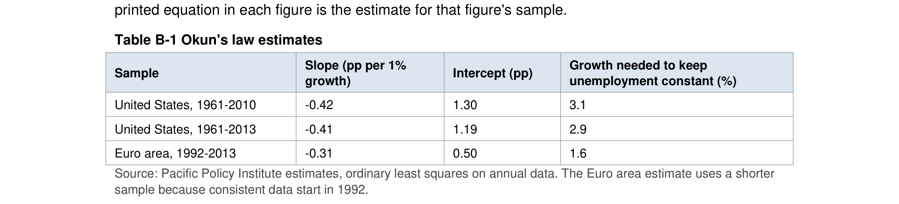

```
DOC3  |  Briefing B: Labour Markets, Prices and Policy Trade-offs
Page 2
B.1 Okun's law revisited
Okun's law relates the change in the unemployment rate to output growth. Document 1 reports a slope
of about -0.4 for the United States, and finds that growth of roughly 3% is needed to keep
unemployment constant. Our re-estimates in Table B-1 confirm this. Figures B-1 and B-2 show the
same scatterplot and fitted line for two samples that differ only by the three years 2011-2013. The
printed equation in each figure is the estimate for that figure's sample.
Table B-1 Okun's law estimates
Sample
Slope (pp per 1%
growth)
Intercept (pp)
Growth needed to keep
unemployment constant (%)
United States, 1961-2010
-0.42
1.30
3.1
United States, 1961-2013
-0.41
1.19
2.9
Euro area, 1992-2013
-0.31
0.50
1.6
Source: Pacific Policy Institute estimates, ordinary least squares on annual data. The Euro area estimate uses a shorter
sample because consistent data start in 1992.
Figure B-1 Okun's law, United States, 1961-2010
Source: PPI estimates.
```

**`DOC3:p2`**

```
DOC3  |  Briefing B: Labour Markets, Prices and Policy Trade-offs
Page 2
B.1 Okun's law revisited
Okun's law relates the change in the unemployment rate to output growth. Document 1 reports a slope
of about -0.4 for the United States, and finds that growth of roughly 3% is needed to keep
unemployment constant. Our re-estimates in Table B-1 confirm this. Figures B-1 and B-2 show the
same scatterplot and fitted line for two samples that differ only by the three years 2011-2013. The
printed equation in each figure is the estimate for that figure's sample.
Table B-1 Okun's law estimates
Sample
Slope (pp per 1%
growth)
Intercept (pp)
Growth needed to keep
unemployment constant (%)
United States, 1961-2010
-0.42
1.30
3.1
United States, 1961-2013
-0.41
1.19
2.9
Euro area, 1992-2013
-0.31
0.50
1.6
Source: Pacific Policy Institute estimates, ordinary least squares on annual data. The Euro area estimate uses a shorter
sample because consistent data start in 1992.
Figure B-1 Okun's law, United States, 1961-2010
Source: PPI estimates.
```

**rating_tejas:** ____

---

## G02

**Question.** What was the US labour force participation rate in 2009 in Table B-2?

**The answer the system gave.** The U.S. labour force participation rate in 2009 was 65.4%.

- status: `answered`
- citations: `DOC3:Table B-2,DOC3:p5`

- the golden set expected: 65.4%

- Shriram rated this **5**

### What the cited sources actually say

**`DOC3:Table B-2`**

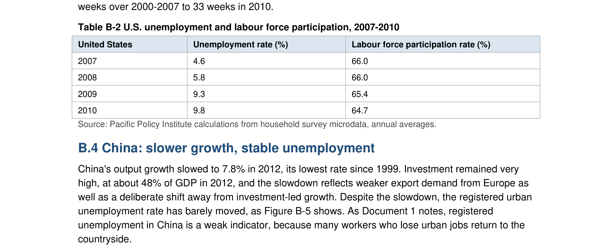

```
DOC3  |  Briefing B: Labour Markets, Prices and Policy Trade-offs
Page 5
B.3 U.S. labour market indicators
Table B-2 reports our calculations of the U.S. unemployment and participation rates as annual
averages from household survey data. Participation fell by 1.3 percentage points between 2007 and
2010. Some workers who lost their jobs stopped looking for work and therefore are not counted as
unemployed. Long-term unemployment also rose sharply: mean duration increased from about 9
weeks over 2000-2007 to 33 weeks in 2010.
Table B-2 U.S. unemployment and labour force participation, 2007-2010
United States
Unemployment rate (%)
Labour force participation rate (%)
2007
4.6
66.0
2008
5.8
66.0
2009
9.3
65.4
2010
9.8
64.7
Source: Pacific Policy Institute calculations from household survey microdata, annual averages.
B.4 China: slower growth, stable unemployment
China's output growth slowed to 7.8% in 2012, its lowest rate since 1999. Investment remained very
high, at about 48% of GDP in 2012, and the slowdown reflects weaker export demand from Europe as
well as a deliberate shift away from investment-led growth. Despite the slowdown, the registered urban
unemployment rate has barely moved, as Figure B-5 shows. As Document 1 notes, registered
unemployment in China is a weak indicator, because many workers who lose urban jobs return to the
countryside.
Figure B-5 Registered urban unemployment rate, China, 2000-2013
Source: PPI compilation of official registered urban unemployment data.
```

**`DOC3:p5`**

```
DOC3  |  Briefing B: Labour Markets, Prices and Policy Trade-offs
Page 5
B.3 U.S. labour market indicators
Table B-2 reports our calculations of the U.S. unemployment and participation rates as annual
averages from household survey data. Participation fell by 1.3 percentage points between 2007 and
2010. Some workers who lost their jobs stopped looking for work and therefore are not counted as
unemployed. Long-term unemployment also rose sharply: mean duration increased from about 9
weeks over 2000-2007 to 33 weeks in 2010.
Table B-2 U.S. unemployment and labour force participation, 2007-2010
United States
Unemployment rate (%)
Labour force participation rate (%)
2007
4.6
66.0
2008
5.8
66.0
2009
9.3
65.4
2010
9.8
64.7
Source: Pacific Policy Institute calculations from household survey microdata, annual averages.
B.4 China: slower growth, stable unemployment
China's output growth slowed to 7.8% in 2012, its lowest rate since 1999. Investment remained very
high, at about 48% of GDP in 2012, and the slowdown reflects weaker export demand from Europe as
well as a deliberate shift away from investment-led growth. Despite the slowdown, the registered urban
unemployment rate has barely moved, as Figure B-5 shows. As Document 1 notes, registered
unemployment in China is a weak indicator, because many workers who lose urban jobs return to the
countryside.
Figure B-5 Registered urban unemployment rate, China, 2000-2013
Source: PPI compilation of official registered urban unemployment data.
```

**rating_tejas:** ____

---

## G03

**Question.** How many weeks was the mean duration of US long-term unemployment in 2010 according to Briefing B?

**The answer the system gave.** The mean duration of US long-term unemployment in 2010 was 33 weeks.

- status: `answered`
- citations: `DOC3:p5`

- the golden set expected: 33 weeks

- Shriram rated this **5**

### What the cited sources actually say

**`DOC3:p5`**

```
DOC3  |  Briefing B: Labour Markets, Prices and Policy Trade-offs
Page 5
B.3 U.S. labour market indicators
Table B-2 reports our calculations of the U.S. unemployment and participation rates as annual
averages from household survey data. Participation fell by 1.3 percentage points between 2007 and
2010. Some workers who lost their jobs stopped looking for work and therefore are not counted as
unemployed. Long-term unemployment also rose sharply: mean duration increased from about 9
weeks over 2000-2007 to 33 weeks in 2010.
Table B-2 U.S. unemployment and labour force participation, 2007-2010
United States
Unemployment rate (%)
Labour force participation rate (%)
2007
4.6
66.0
2008
5.8
66.0
2009
9.3
65.4
2010
9.8
64.7
Source: Pacific Policy Institute calculations from household survey microdata, annual averages.
B.4 China: slower growth, stable unemployment
China's output growth slowed to 7.8% in 2012, its lowest rate since 1999. Investment remained very
high, at about 48% of GDP in 2012, and the slowdown reflects weaker export demand from Europe as
well as a deliberate shift away from investment-led growth. Despite the slowdown, the registered urban
unemployment rate has barely moved, as Figure B-5 shows. As Document 1 notes, registered
unemployment in China is a weak indicator, because many workers who lose urban jobs return to the
countryside.
Figure B-5 Registered urban unemployment rate, China, 2000-2013
Source: PPI compilation of official registered urban unemployment data.
```

**rating_tejas:** ____

---

## G04

**Question.** What share of GDP did investment represent in China in 2012 according to Briefing B?

**The answer the system gave.** Investment represented about 48% of GDP in China in 2012.

- status: `answered`
- citations: `DOC3:p5,DOC3:Table B-2`

- the golden set expected: about 48%

- Shriram rated this **5**

### What the cited sources actually say

**`DOC3:p5`**

```
DOC3  |  Briefing B: Labour Markets, Prices and Policy Trade-offs
Page 5
B.3 U.S. labour market indicators
Table B-2 reports our calculations of the U.S. unemployment and participation rates as annual
averages from household survey data. Participation fell by 1.3 percentage points between 2007 and
2010. Some workers who lost their jobs stopped looking for work and therefore are not counted as
unemployed. Long-term unemployment also rose sharply: mean duration increased from about 9
weeks over 2000-2007 to 33 weeks in 2010.
Table B-2 U.S. unemployment and labour force participation, 2007-2010
United States
Unemployment rate (%)
Labour force participation rate (%)
2007
4.6
66.0
2008
5.8
66.0
2009
9.3
65.4
2010
9.8
64.7
Source: Pacific Policy Institute calculations from household survey microdata, annual averages.
B.4 China: slower growth, stable unemployment
China's output growth slowed to 7.8% in 2012, its lowest rate since 1999. Investment remained very
high, at about 48% of GDP in 2012, and the slowdown reflects weaker export demand from Europe as
well as a deliberate shift away from investment-led growth. Despite the slowdown, the registered urban
unemployment rate has barely moved, as Figure B-5 shows. As Document 1 notes, registered
unemployment in China is a weak indicator, because many workers who lose urban jobs return to the
countryside.
Figure B-5 Registered urban unemployment rate, China, 2000-2013
Source: PPI compilation of official registered urban unemployment data.
```

**`DOC3:Table B-2`**


```
DOC3  |  Briefing B: Labour Markets, Prices and Policy Trade-offs
Page 5
B.3 U.S. labour market indicators
Table B-2 reports our calculations of the U.S. unemployment and participation rates as annual
averages from household survey data. Participation fell by 1.3 percentage points between 2007 and
2010. Some workers who lost their jobs stopped looking for work and therefore are not counted as
unemployed. Long-term unemployment also rose sharply: mean duration increased from about 9
weeks over 2000-2007 to 33 weeks in 2010.
Table B-2 U.S. unemployment and labour force participation, 2007-2010
United States
Unemployment rate (%)
Labour force participation rate (%)
2007
4.6
66.0
2008
5.8
66.0
2009
9.3
65.4
2010
9.8
64.7
Source: Pacific Policy Institute calculations from household survey microdata, annual averages.
B.4 China: slower growth, stable unemployment
China's output growth slowed to 7.8% in 2012, its lowest rate since 1999. Investment remained very
high, at about 48% of GDP in 2012, and the slowdown reflects weaker export demand from Europe as
well as a deliberate shift away from investment-led growth. Despite the slowdown, the registered urban
unemployment rate has barely moved, as Figure B-5 shows. As Document 1 notes, registered
unemployment in China is a weak indicator, because many workers who lose urban jobs return to the
countryside.
Figure B-5 Registered urban unemployment rate, China, 2000-2013
Source: PPI compilation of official registered urban unemployment data.
```

**rating_tejas:** ____

---

## G05

**Question.** What slope does Table B-1 report for the US 1961-2010 Okun's law estimate?

**The answer the system gave.** -0.42

- status: `answered`
- citations: `DOC3:Table B-1,DOC3:p2`

- the golden set expected: -0.42

- Shriram rated this **5**

### What the cited sources actually say

**`DOC3:Table B-1`**


```
DOC3  |  Briefing B: Labour Markets, Prices and Policy Trade-offs
Page 2
B.1 Okun's law revisited
Okun's law relates the change in the unemployment rate to output growth. Document 1 reports a slope
of about -0.4 for the United States, and finds that growth of roughly 3% is needed to keep
unemployment constant. Our re-estimates in Table B-1 confirm this. Figures B-1 and B-2 show the
same scatterplot and fitted line for two samples that differ only by the three years 2011-2013. The
printed equation in each figure is the estimate for that figure's sample.
Table B-1 Okun's law estimates
Sample
Slope (pp per 1%
growth)
Intercept (pp)
Growth needed to keep
unemployment constant (%)
United States, 1961-2010
-0.42
1.30
3.1
United States, 1961-2013
-0.41
1.19
2.9
Euro area, 1992-2013
-0.31
0.50
1.6
Source: Pacific Policy Institute estimates, ordinary least squares on annual data. The Euro area estimate uses a shorter
sample because consistent data start in 1992.
Figure B-1 Okun's law, United States, 1961-2010
Source: PPI estimates.
```

**`DOC3:p2`**

```
DOC3  |  Briefing B: Labour Markets, Prices and Policy Trade-offs
Page 2
B.1 Okun's law revisited
Okun's law relates the change in the unemployment rate to output growth. Document 1 reports a slope
of about -0.4 for the United States, and finds that growth of roughly 3% is needed to keep
unemployment constant. Our re-estimates in Table B-1 confirm this. Figures B-1 and B-2 show the
same scatterplot and fitted line for two samples that differ only by the three years 2011-2013. The
printed equation in each figure is the estimate for that figure's sample.
Table B-1 Okun's law estimates
Sample
Slope (pp per 1%
growth)
Intercept (pp)
Growth needed to keep
unemployment constant (%)
United States, 1961-2010
-0.42
1.30
3.1
United States, 1961-2013
-0.41
1.19
2.9
Euro area, 1992-2013
-0.31
0.50
1.6
Source: Pacific Policy Institute estimates, ordinary least squares on annual data. The Euro area estimate uses a shorter
sample because consistent data start in 1992.
Figure B-1 Okun's law, United States, 1961-2010
Source: PPI estimates.
```

**rating_tejas:** ____

---

## G06

**Question.** Which inflation measures are compared in Figure B-3?

**The answer the system gave.** Figure B-3 compares the headline Consumer Price Index (CPI) with the GDP deflator.

- status: `answered`
- citations: `DOC3:Figure B-3,DOC3:p4`

- the golden set expected: Headline CPI inflation and GDP deflator inflation

- Shriram rated this **5**

### What the cited sources actually say

**`DOC3:Figure B-3`**

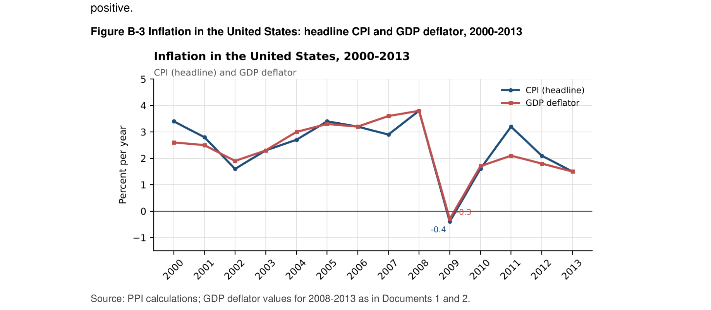

```
DOC3  |  Briefing B: Labour Markets, Prices and Policy Trade-offs
Page 4
B.2 Two ways of measuring inflation
Document 1 explains that the CPI and the GDP deflator usually move together. Figures B-3 and B-4
both show headline CPI inflation for 2000-2013, but they compare it with different measures. Figure B-3
compares it with inflation measured by the GDP deflator. Figure B-4 compares it with core CPI inflation,
which excludes food and energy prices. The headline CPI line is identical in the two figures.
The 2009 values show why the distinction matters. Headline CPI inflation turned negative in 2009
because energy prices collapsed. The GDP deflator also fell slightly, but core CPI inflation stayed
positive.
Figure B-3 Inflation in the United States: headline CPI and GDP deflator, 2000-2013
Source: PPI calculations; GDP deflator values for 2008-2013 as in Documents 1 and 2.
Figure B-4 Inflation in the United States: headline CPI and core CPI, 2000-2013
Source: PPI calculations.
```

**`DOC3:p4`**

```
DOC3  |  Briefing B: Labour Markets, Prices and Policy Trade-offs
Page 4
B.2 Two ways of measuring inflation
Document 1 explains that the CPI and the GDP deflator usually move together. Figures B-3 and B-4
both show headline CPI inflation for 2000-2013, but they compare it with different measures. Figure B-3
compares it with inflation measured by the GDP deflator. Figure B-4 compares it with core CPI inflation,
which excludes food and energy prices. The headline CPI line is identical in the two figures.
The 2009 values show why the distinction matters. Headline CPI inflation turned negative in 2009
because energy prices collapsed. The GDP deflator also fell slightly, but core CPI inflation stayed
positive.
Figure B-3 Inflation in the United States: headline CPI and GDP deflator, 2000-2013
Source: PPI calculations; GDP deflator values for 2008-2013 as in Documents 1 and 2.
Figure B-4 Inflation in the United States: headline CPI and core CPI, 2000-2013
Source: PPI calculations.
```

**rating_tejas:** ____

---

## G07

**Question.** Which inflation measures are compared in Figure B-4?

**The answer the system gave.** Figure B-4 compares the headline CPI with the core CPI (excluding food and energy prices).

- status: `answered`
- citations: `DOC3:Figure B-4,DOC3:p4`

- the golden set expected: Headline CPI inflation and core CPI inflation

- Shriram rated this **5**

### What the cited sources actually say

**`DOC3:Figure B-4`**

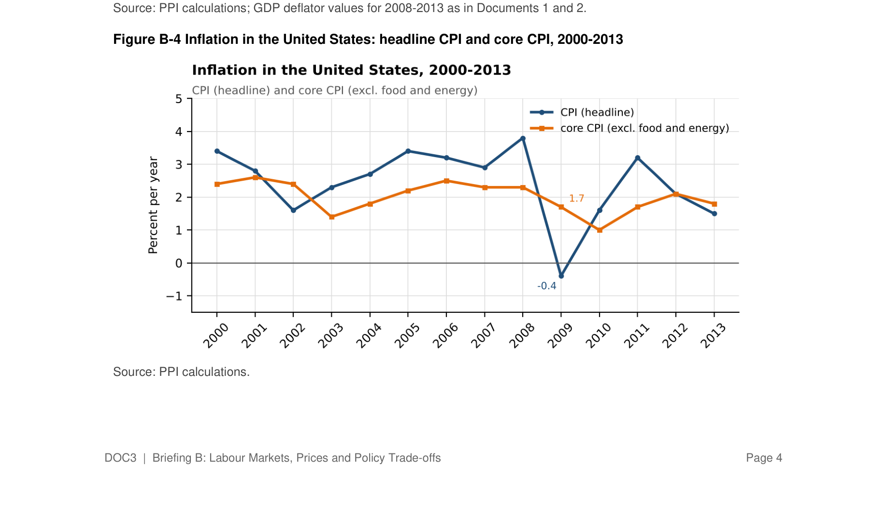

```
DOC3  |  Briefing B: Labour Markets, Prices and Policy Trade-offs
Page 4
B.2 Two ways of measuring inflation
Document 1 explains that the CPI and the GDP deflator usually move together. Figures B-3 and B-4
both show headline CPI inflation for 2000-2013, but they compare it with different measures. Figure B-3
compares it with inflation measured by the GDP deflator. Figure B-4 compares it with core CPI inflation,
which excludes food and energy prices. The headline CPI line is identical in the two figures.
The 2009 values show why the distinction matters. Headline CPI inflation turned negative in 2009
because energy prices collapsed. The GDP deflator also fell slightly, but core CPI inflation stayed
positive.
Figure B-3 Inflation in the United States: headline CPI and GDP deflator, 2000-2013
Source: PPI calculations; GDP deflator values for 2008-2013 as in Documents 1 and 2.
Figure B-4 Inflation in the United States: headline CPI and core CPI, 2000-2013
Source: PPI calculations.
```

**`DOC3:p4`**

```
DOC3  |  Briefing B: Labour Markets, Prices and Policy Trade-offs
Page 4
B.2 Two ways of measuring inflation
Document 1 explains that the CPI and the GDP deflator usually move together. Figures B-3 and B-4
both show headline CPI inflation for 2000-2013, but they compare it with different measures. Figure B-3
compares it with inflation measured by the GDP deflator. Figure B-4 compares it with core CPI inflation,
which excludes food and energy prices. The headline CPI line is identical in the two figures.
The 2009 values show why the distinction matters. Headline CPI inflation turned negative in 2009
because energy prices collapsed. The GDP deflator also fell slightly, but core CPI inflation stayed
positive.
Figure B-3 Inflation in the United States: headline CPI and GDP deflator, 2000-2013
Source: PPI calculations; GDP deflator values for 2008-2013 as in Documents 1 and 2.
Figure B-4 Inflation in the United States: headline CPI and core CPI, 2000-2013
Source: PPI calculations.
```

**rating_tejas:** ____

---

## G08

**Question.** What sample period is represented by Figure B-1?

**The answer the system gave.** Figure B-1 represents the period from 1961 to 2010.

- status: `answered`
- citations: `DOC3:Figure B-1,DOC3:p2`

- the golden set expected: 1961-2010

- Shriram rated this **5**

### What the cited sources actually say

**`DOC3:Figure B-1`**

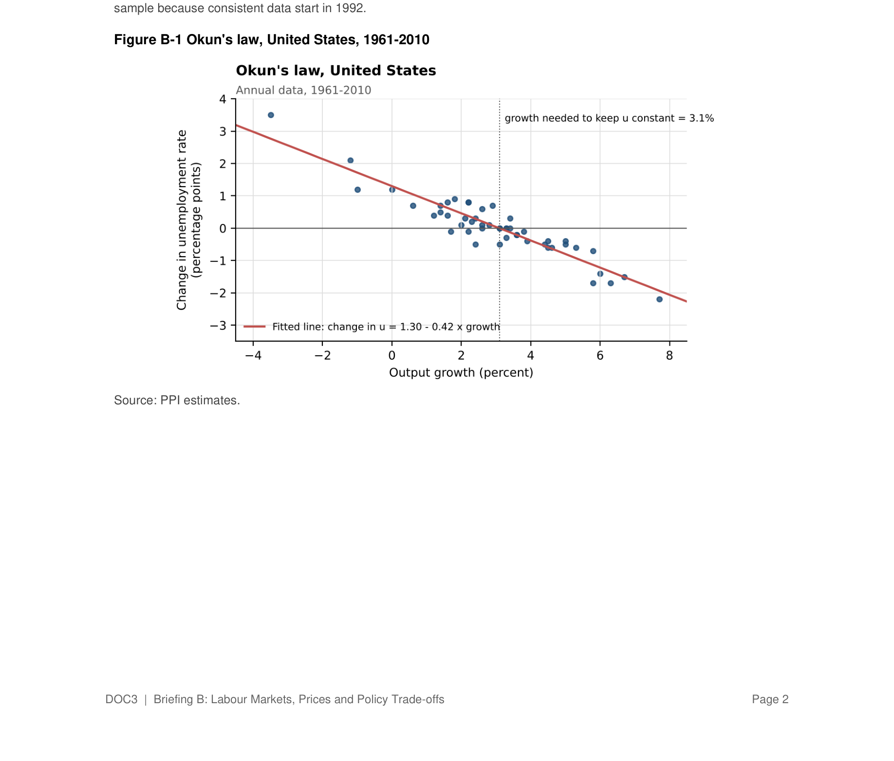

```
DOC3  |  Briefing B: Labour Markets, Prices and Policy Trade-offs
Page 2
B.1 Okun's law revisited
Okun's law relates the change in the unemployment rate to output growth. Document 1 reports a slope
of about -0.4 for the United States, and finds that growth of roughly 3% is needed to keep
unemployment constant. Our re-estimates in Table B-1 confirm this. Figures B-1 and B-2 show the
same scatterplot and fitted line for two samples that differ only by the three years 2011-2013. The
printed equation in each figure is the estimate for that figure's sample.
Table B-1 Okun's law estimates
Sample
Slope (pp per 1%
growth)
Intercept (pp)
Growth needed to keep
unemployment constant (%)
United States, 1961-2010
-0.42
1.30
3.1
United States, 1961-2013
-0.41
1.19
2.9
Euro area, 1992-2013
-0.31
0.50
1.6
Source: Pacific Policy Institute estimates, ordinary least squares on annual data. The Euro area estimate uses a shorter
sample because consistent data start in 1992.
Figure B-1 Okun's law, United States, 1961-2010
Source: PPI estimates.
```

**`DOC3:p2`**

```
DOC3  |  Briefing B: Labour Markets, Prices and Policy Trade-offs
Page 2
B.1 Okun's law revisited
Okun's law relates the change in the unemployment rate to output growth. Document 1 reports a slope
of about -0.4 for the United States, and finds that growth of roughly 3% is needed to keep
unemployment constant. Our re-estimates in Table B-1 confirm this. Figures B-1 and B-2 show the
same scatterplot and fitted line for two samples that differ only by the three years 2011-2013. The
printed equation in each figure is the estimate for that figure's sample.
Table B-1 Okun's law estimates
Sample
Slope (pp per 1%
growth)
Intercept (pp)
Growth needed to keep
unemployment constant (%)
United States, 1961-2010
-0.42
1.30
3.1
United States, 1961-2013
-0.41
1.19
2.9
Euro area, 1992-2013
-0.31
0.50
1.6
Source: Pacific Policy Institute estimates, ordinary least squares on annual data. The Euro area estimate uses a shorter
sample because consistent data start in 1992.
Figure B-1 Okun's law, United States, 1961-2010
Source: PPI estimates.
```

**rating_tejas:** ____

---

## G09

**Question.** What sample period is represented by Figure B-2?

**The answer the system gave.** Figure B-2 represents the period from 1961 to 2013.

- status: `answered`
- citations: `DOC3:Figure B-2,DOC3:p3`

- the golden set expected: 1961-2013

- Shriram rated this **5**

### What the cited sources actually say

**`DOC3:Figure B-2`**

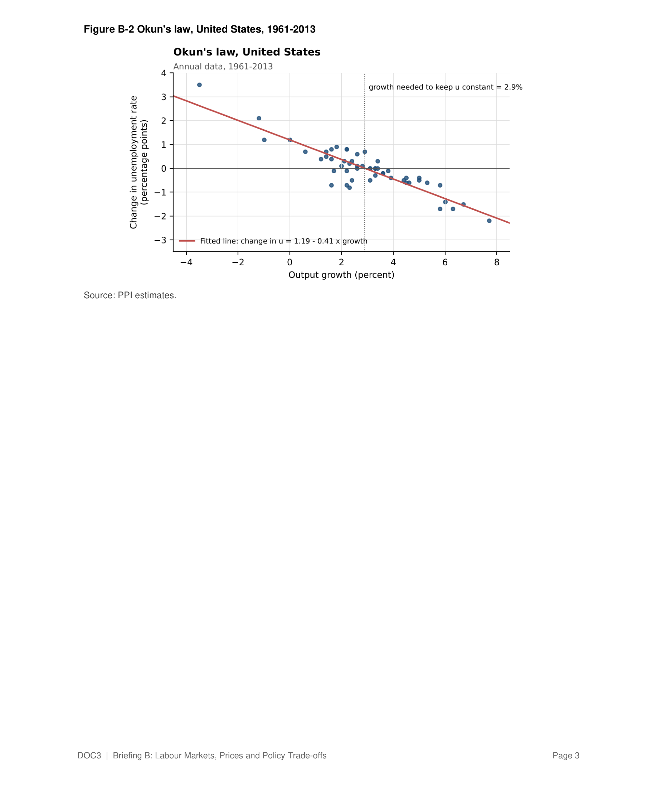

```
DOC3  |  Briefing B: Labour Markets, Prices and Policy Trade-offs
Page 3
Figure B-2 Okun's law, United States, 1961-2013
Source: PPI estimates.
```

**`DOC3:p3`**

```
DOC3  |  Briefing B: Labour Markets, Prices and Policy Trade-offs
Page 3
Figure B-2 Okun's law, United States, 1961-2013
Source: PPI estimates.
```

**rating_tejas:** ____

---

## G10

**Question.** In Figure A-4 (January 2007 = 1.0), what was the Euro area stock price index in December 2010?

**The answer the system gave.** The Euro area stock price index in December 2010 was 0.66.

- status: `answered`
- citations: `DOC2:Figure A-4,DOC2:p5`

- the golden set expected: 0.66

- Shriram rated this **5**

### What the cited sources actually say

**`DOC2:Figure A-4`**

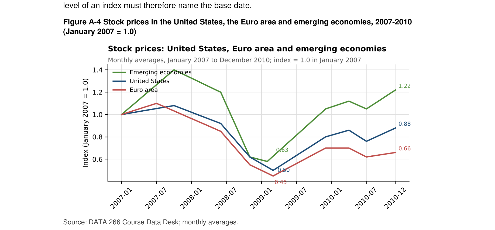

```
DOC2  |  Supplement A: Outturns, Revisions and Forecast Errors, 2011-2013
Page 5
A.4 Stock markets: two base dates
Figures A-4 and A-5 plot the same three monthly stock price indexes over the same period. Figure A-4
sets each index to 1.0 in January 2007, as in Figure 1-1 of Document 1. Figure A-5 divides each series
by its January 2009 value, so each index equals 1.0 in January 2009. Rebasing changes every level
but not the shape of each line or the percentage change between any two months. Questions about the
level of an index must therefore name the base date.
Figure A-4 Stock prices in the United States, the Euro area and emerging economies, 2007-2010
(January 2007 = 1.0)
Source: DATA 266 Course Data Desk; monthly averages.
Figure A-5 Stock prices in the United States, the Euro area and emerging economies, 2007-2010
(January 2009 = 1.0)
Source: as Figure A-4, rebased to January 2009.
```

**`DOC2:p5`**

```
DOC2  |  Supplement A: Outturns, Revisions and Forecast Errors, 2011-2013
Page 5
A.4 Stock markets: two base dates
Figures A-4 and A-5 plot the same three monthly stock price indexes over the same period. Figure A-4
sets each index to 1.0 in January 2007, as in Figure 1-1 of Document 1. Figure A-5 divides each series
by its January 2009 value, so each index equals 1.0 in January 2009. Rebasing changes every level
but not the shape of each line or the percentage change between any two months. Questions about the
level of an index must therefore name the base date.
Figure A-4 Stock prices in the United States, the Euro area and emerging economies, 2007-2010
(January 2007 = 1.0)
Source: DATA 266 Course Data Desk; monthly averages.
Figure A-5 Stock prices in the United States, the Euro area and emerging economies, 2007-2010
(January 2009 = 1.0)
Source: as Figure A-4, rebased to January 2009.
```

**rating_tejas:** ____

---

## G11

**Question.** In Figure A-5 (January 2009 = 1.0), what was the emerging economies stock price index in December 2010?

**The answer the system gave.** The emerging economies stock price index in December 2010 was 2.00.

- status: `answered`
- citations: `DOC2:Figure A-5,DOC2:p5`

- the golden set expected: 2.06

- Shriram rated this **3**

### What the cited sources actually say

**`DOC2:Figure A-5`**

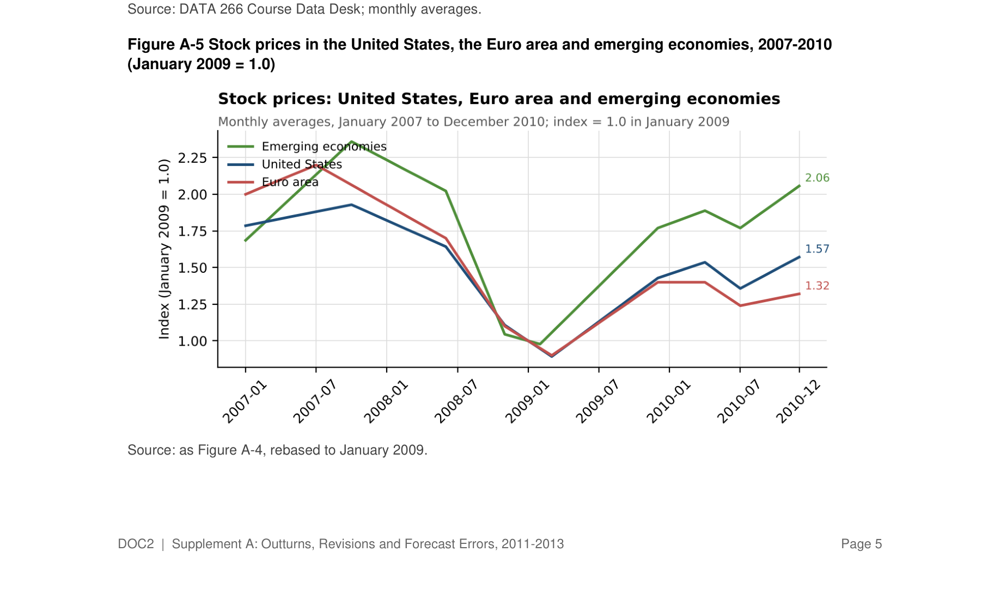

```
DOC2  |  Supplement A: Outturns, Revisions and Forecast Errors, 2011-2013
Page 5
A.4 Stock markets: two base dates
Figures A-4 and A-5 plot the same three monthly stock price indexes over the same period. Figure A-4
sets each index to 1.0 in January 2007, as in Figure 1-1 of Document 1. Figure A-5 divides each series
by its January 2009 value, so each index equals 1.0 in January 2009. Rebasing changes every level
but not the shape of each line or the percentage change between any two months. Questions about the
level of an index must therefore name the base date.
Figure A-4 Stock prices in the United States, the Euro area and emerging economies, 2007-2010
(January 2007 = 1.0)
Source: DATA 266 Course Data Desk; monthly averages.
Figure A-5 Stock prices in the United States, the Euro area and emerging economies, 2007-2010
(January 2009 = 1.0)
Source: as Figure A-4, rebased to January 2009.
```

**`DOC2:p5`**

```
DOC2  |  Supplement A: Outturns, Revisions and Forecast Errors, 2011-2013
Page 5
A.4 Stock markets: two base dates
Figures A-4 and A-5 plot the same three monthly stock price indexes over the same period. Figure A-4
sets each index to 1.0 in January 2007, as in Figure 1-1 of Document 1. Figure A-5 divides each series
by its January 2009 value, so each index equals 1.0 in January 2009. Rebasing changes every level
but not the shape of each line or the percentage change between any two months. Questions about the
level of an index must therefore name the base date.
Figure A-4 Stock prices in the United States, the Euro area and emerging economies, 2007-2010
(January 2007 = 1.0)
Source: DATA 266 Course Data Desk; monthly averages.
Figure A-5 Stock prices in the United States, the Euro area and emerging economies, 2007-2010
(January 2009 = 1.0)
Source: as Figure A-4, rebased to January 2009.
```

**rating_tejas:** ____

---

## G12

**Question.** How does Document 1 define the unemployment rate, and why does Briefing B say that rate understated US labour-market weakness during the crisis?

**The answer the system gave.** Document 1 defines the unemployment rate as the percentage of the labor force that is unemployed. Briefing B states that the unemployment rate understates the weakness of the US labor market during the crisis because participation in the U.S. labor force fell, leading to some workers who lost their jobs stopping to look for work and thus not being counted as unemployed.

- status: `answered`
- citations: `DOC3:p1,DOC3:p5`

- the golden set expected: Document 1 defines it as unemployed people divided by the labour force; Briefing B says falling participation meant some people who stopped looking for work were no longer counted as unemployed.

- Shriram rated this **4**

### What the cited sources actually say

**`DOC3:p1`**

```
DOC3  |  Briefing B: Labour Markets, Prices and Policy Trade-offs
Page 1
Briefing B
Labour Markets, Prices and Policy Trade-offs
after the Crisis
Document ID
DOC3
Publisher
Pacific Policy Institute (policy research group)
Date
30 June 2014
Source classification
Policy briefing (secondary analysis). Sections B.1-B.4 and the Erratum.
Trust level
Medium for Sections B.1-B.4 and the Erratum. Low for Appendix C (unverified reader
commentary).
Relationship to Documents 1
and 2
Re-estimates relations introduced in Document 1, Chapter 2 (Okun's law, inflation
measures) and discusses labour markets and China. Uses its own calculations, which
are not always identical to Documents 1 and 2.
Teaching document. Prepared for DATA 266 Lab 2 as part of the base knowledge base. Values for 2000-2010 follow
Document 1 (Blanchard, Macroeconomics, Chapters 1-2) wherever Document 1 reports them, unless a revision is stated
explicitly. All other values are constructed for teaching and evaluation and must not be cited as official statistics.
Contents: B.1 Okun's law revisited; B.2 Two ways of measuring inflation; B.3 U.S. labour market indicators; B.4 China:
slower growth, stable unemployment; Erratum; Appendix C Unverified reader commentary.
Key messages
1. Okun's law has held up well through the crisis: adding 2011-2013 barely changes the estimated
slope.
2. Headline CPI inflation is far more volatile than either the GDP deflator or core CPI, mostly because of
energy prices. In 2009 the gap between headline and core CPI inflation was unusually large.
3. Participation in the U.S. labour force fell during the crisis, so the unemployment rate understates the
weakness of the labour market.
4. China's growth has slowed, but its registered urban unemployment rate has not moved.
```

**`DOC3:p5`**

```
DOC3  |  Briefing B: Labour Markets, Prices and Policy Trade-offs
Page 5
B.3 U.S. labour market indicators
Table B-2 reports our calculations of the U.S. unemployment and participation rates as annual
averages from household survey data. Participation fell by 1.3 percentage points between 2007 and
2010. Some workers who lost their jobs stopped looking for work and therefore are not counted as
unemployed. Long-term unemployment also rose sharply: mean duration increased from about 9
weeks over 2000-2007 to 33 weeks in 2010.
Table B-2 U.S. unemployment and labour force participation, 2007-2010
United States
Unemployment rate (%)
Labour force participation rate (%)
2007
4.6
66.0
2008
5.8
66.0
2009
9.3
65.4
2010
9.8
64.7
Source: Pacific Policy Institute calculations from household survey microdata, annual averages.
B.4 China: slower growth, stable unemployment
China's output growth slowed to 7.8% in 2012, its lowest rate since 1999. Investment remained very
high, at about 48% of GDP in 2012, and the slowdown reflects weaker export demand from Europe as
well as a deliberate shift away from investment-led growth. Despite the slowdown, the registered urban
unemployment rate has barely moved, as Figure B-5 shows. As Document 1 notes, registered
unemployment in China is a weak indicator, because many workers who lose urban jobs return to the
countryside.
Figure B-5 Registered urban unemployment rate, China, 2000-2013
Source: PPI compilation of official registered urban unemployment data.
```

**rating_tejas:** ____

---

## G13

**Question.** How did extending the US Okun's law sample through 2013 change the estimated slope and the growth needed to keep unemployment constant?

**The answer the system gave.** Extending the US Okun's law sample through 2013 reduced the slope from -0.42 to -0.41 and decreased the growth needed to keep unemployment constant from 3.1% to 2.9%.

- status: `answered`
- citations: `DOC3:Table B-1,DOC3:p2,DOC3:Figure B-2,DOC3:p3`

- the golden set expected: The slope changed from -0.42 to -0.41 and the required growth rate fell from 3.1% to 2.9%.

- Shriram rated this **5**

### What the cited sources actually say

**`DOC3:Table B-1`**


```
DOC3  |  Briefing B: Labour Markets, Prices and Policy Trade-offs
Page 2
B.1 Okun's law revisited
Okun's law relates the change in the unemployment rate to output growth. Document 1 reports a slope
of about -0.4 for the United States, and finds that growth of roughly 3% is needed to keep
unemployment constant. Our re-estimates in Table B-1 confirm this. Figures B-1 and B-2 show the
same scatterplot and fitted line for two samples that differ only by the three years 2011-2013. The
printed equation in each figure is the estimate for that figure's sample.
Table B-1 Okun's law estimates
Sample
Slope (pp per 1%
growth)
Intercept (pp)
Growth needed to keep
unemployment constant (%)
United States, 1961-2010
-0.42
1.30
3.1
United States, 1961-2013
-0.41
1.19
2.9
Euro area, 1992-2013
-0.31
0.50
1.6
Source: Pacific Policy Institute estimates, ordinary least squares on annual data. The Euro area estimate uses a shorter
sample because consistent data start in 1992.
Figure B-1 Okun's law, United States, 1961-2010
Source: PPI estimates.
```

**`DOC3:p2`**

```
DOC3  |  Briefing B: Labour Markets, Prices and Policy Trade-offs
Page 2
B.1 Okun's law revisited
Okun's law relates the change in the unemployment rate to output growth. Document 1 reports a slope
of about -0.4 for the United States, and finds that growth of roughly 3% is needed to keep
unemployment constant. Our re-estimates in Table B-1 confirm this. Figures B-1 and B-2 show the
same scatterplot and fitted line for two samples that differ only by the three years 2011-2013. The
printed equation in each figure is the estimate for that figure's sample.
Table B-1 Okun's law estimates
Sample
Slope (pp per 1%
growth)
Intercept (pp)
Growth needed to keep
unemployment constant (%)
United States, 1961-2010
-0.42
1.30
3.1
United States, 1961-2013
-0.41
1.19
2.9
Euro area, 1992-2013
-0.31
0.50
1.6
Source: Pacific Policy Institute estimates, ordinary least squares on annual data. The Euro area estimate uses a shorter
sample because consistent data start in 1992.
Figure B-1 Okun's law, United States, 1961-2010
Source: PPI estimates.
```

**`DOC3:Figure B-2`**


```
DOC3  |  Briefing B: Labour Markets, Prices and Policy Trade-offs
Page 3
Figure B-2 Okun's law, United States, 1961-2013
Source: PPI estimates.
```

**`DOC3:p3`**

```
DOC3  |  Briefing B: Labour Markets, Prices and Policy Trade-offs
Page 3
Figure B-2 Okun's law, United States, 1961-2013
Source: PPI estimates.
```

**rating_tejas:** ____

---

## G14

**Question.** How does the growth rate needed to keep unemployment constant in the Euro area (Briefing B) compare with the roughly 3% that Document 1 gives for the United States?

**The answer the system gave.** The growth rate needed to keep unemployment constant in the Euro area, according to Table B-1, is 1.6%, which is lower than the 3% reported for the United States in Document 1.

- status: `answered`
- citations: `DOC3:Table B-1,DOC3:p2`

- the golden set expected: The Euro area needs only 1.6%, much less than the roughly 3% for the United States.

- Shriram rated this **5**

### What the cited sources actually say

**`DOC3:Table B-1`**


```
DOC3  |  Briefing B: Labour Markets, Prices and Policy Trade-offs
Page 2
B.1 Okun's law revisited
Okun's law relates the change in the unemployment rate to output growth. Document 1 reports a slope
of about -0.4 for the United States, and finds that growth of roughly 3% is needed to keep
unemployment constant. Our re-estimates in Table B-1 confirm this. Figures B-1 and B-2 show the
same scatterplot and fitted line for two samples that differ only by the three years 2011-2013. The
printed equation in each figure is the estimate for that figure's sample.
Table B-1 Okun's law estimates
Sample
Slope (pp per 1%
growth)
Intercept (pp)
Growth needed to keep
unemployment constant (%)
United States, 1961-2010
-0.42
1.30
3.1
United States, 1961-2013
-0.41
1.19
2.9
Euro area, 1992-2013
-0.31
0.50
1.6
Source: Pacific Policy Institute estimates, ordinary least squares on annual data. The Euro area estimate uses a shorter
sample because consistent data start in 1992.
Figure B-1 Okun's law, United States, 1961-2010
Source: PPI estimates.
```

**`DOC3:p2`**

```
DOC3  |  Briefing B: Labour Markets, Prices and Policy Trade-offs
Page 2
B.1 Okun's law revisited
Okun's law relates the change in the unemployment rate to output growth. Document 1 reports a slope
of about -0.4 for the United States, and finds that growth of roughly 3% is needed to keep
unemployment constant. Our re-estimates in Table B-1 confirm this. Figures B-1 and B-2 show the
same scatterplot and fitted line for two samples that differ only by the three years 2011-2013. The
printed equation in each figure is the estimate for that figure's sample.
Table B-1 Okun's law estimates
Sample
Slope (pp per 1%
growth)
Intercept (pp)
Growth needed to keep
unemployment constant (%)
United States, 1961-2010
-0.42
1.30
3.1
United States, 1961-2013
-0.41
1.19
2.9
Euro area, 1992-2013
-0.31
0.50
1.6
Source: Pacific Policy Institute estimates, ordinary least squares on annual data. The Euro area estimate uses a shorter
sample because consistent data start in 1992.
Figure B-1 Okun's law, United States, 1961-2010
Source: PPI estimates.
```

**rating_tejas:** ____

---

## G15

**Question.** For this conversation, assume China's 2012 investment share was 60% of GDP.

**The answer the system gave.** For this conversation, China's 2012 investment share was assumed to be 60% of GDP.

- status: `session_override`
- citations: `DOC1:p10,DOC1:Figure 1-6`

- the golden set expected: Use 60% for this conversation; documents report about 48%.

- Shriram rated this **2**

### What the cited sources actually say

**`DOC1:p10`**

```
Chapter 1 
A Tour of the World 
13
1-4 China
China is in the news every day. It is increasingly seen as one of the major economic 
powers in the world. Is the attention justified? A first look at the numbers in Figure 1-6 
suggests it may not be. True, the population of China is enormous, more than four times 
that of the United States. But its output, expressed in dollars by multiplying the number 
in yuans (the Chinese currency) by the dollar–yuan exchange rate, is only 5.8 trillion 
dollars, less than half that of the United States. Output per person is only $4,300, roughly 
one-tenth of output per person in the United States.
So why is so much attention paid to China? There are two reasons. To understand 
the first, we need to go back to the number for output per person. When compar-
ing output per person in a rich country like the United States and a relatively poor 
country like China, one must be careful. The reason is that many goods are cheaper 
in poor countries. For example, the price of an average restaurant meal in New York 
City is about 20 dollars; the price of an average restaurant meal in Beijing is about 25 
yuans, or, at the current exchange rate, about 4 dollars. Put another way, the same 
income (expressed in dollars) buys you much more in Beijing than in New York City. 
If we want to compare standards of living, we have to correct for these differences; 
measures which do so are called PPP (for purchasing power parity) measures. Using 
such a measure, output per person in China is estimated to be about $7,500, roughly 
one-sixth of the output per person in the United States. This gives a more accurate 
picture of the standard of living in China. It is obviously still much lower than that of 
the United States or other rich countries. But it is higher than suggested by the num-
bers in Figure 1-6.
Second, and more importantly, China has been growing rapidly for more than 
three decades. This is shown in Table 1-4, which gives output growth, unemployment, 
and inflation for the periods 1980–1999, 2000–2007, and each of the years 2008 to 2012. 
The numbers for 2011 and 2012 are forecasts as of the fall of 2011.
Look at the first two columns of Table 1-4. The most impressive numbers are those 
for output growth. Since 1980, China’s output has grown at roughly 10% a year. This 
The issue is less important 
when comparing two rich 
countries. Thus, this was not 
a major issue when compar-
ing standards of living in the 
United States and the euro 
area earlier.
Figure 1-6
China
China, 2010
Output: $5.8 trillion
Population: 1,340 million
Output per person: $4,300
Share of world output: 9.3%

```

**`DOC1:Figure 1-6`**

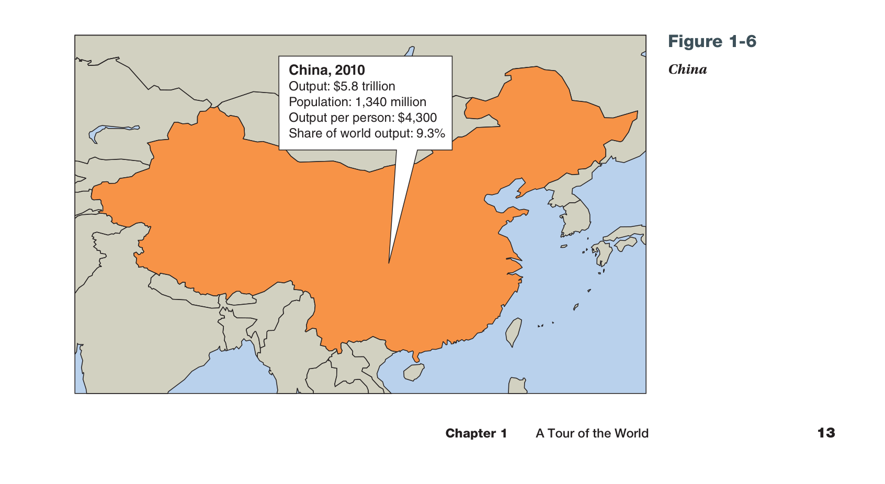

```
Chapter 1 
A Tour of the World 
13
1-4 China
China is in the news every day. It is increasingly seen as one of the major economic 
powers in the world. Is the attention justified? A first look at the numbers in Figure 1-6 
suggests it may not be. True, the population of China is enormous, more than four times 
that of the United States. But its output, expressed in dollars by multiplying the number 
in yuans (the Chinese currency) by the dollar–yuan exchange rate, is only 5.8 trillion 
dollars, less than half that of the United States. Output per person is only $4,300, roughly 
one-tenth of output per person in the United States.
So why is so much attention paid to China? There are two reasons. To understand 
the first, we need to go back to the number for output per person. When compar-
ing output per person in a rich country like the United States and a relatively poor 
country like China, one must be careful. The reason is that many goods are cheaper 
in poor countries. For example, the price of an average restaurant meal in New York 
City is about 20 dollars; the price of an average restaurant meal in Beijing is about 25 
yuans, or, at the current exchange rate, about 4 dollars. Put another way, the same 
income (expressed in dollars) buys you much more in Beijing than in New York City. 
If we want to compare standards of living, we have to correct for these differences; 
measures which do so are called PPP (for purchasing power parity) measures. Using 
such a measure, output per person in China is estimated to be about $7,500, roughly 
one-sixth of the output per person in the United States. This gives a more accurate 
picture of the standard of living in China. It is obviously still much lower than that of 
the United States or other rich countries. But it is higher than suggested by the num-
bers in Figure 1-6.
Second, and more importantly, China has been growing rapidly for more than 
three decades. This is shown in Table 1-4, which gives output growth, unemployment, 
and inflation for the periods 1980–1999, 2000–2007, and each of the years 2008 to 2012. 
The numbers for 2011 and 2012 are forecasts as of the fall of 2011.
Look at the first two columns of Table 1-4. The most impressive numbers are those 
for output growth. Since 1980, China’s output has grown at roughly 10% a year. This 
The issue is less important 
when comparing two rich 
countries. Thus, this was not 
a major issue when compar-
ing standards of living in the 
United States and the euro 
area earlier.
Figure 1-6
China
China, 2010
Output: $5.8 trillion
Population: 1,340 million
Output per person: $4,300
Share of world output: 9.3%

```

**rating_tejas:** ____

---

## G16

**Question.** What investment share should we use for China in 2012?

**The answer the system gave.** For this conversation, China's 2012 investment share was assumed to be 60% of GDP.

- status: `session_override`
- citations: `DOC1:p10,DOC1:p11,DOC3:Table B-2,DOC3:p5`

- the golden set expected: 60% for this conversation; documents report about 48%.

- Shriram rated this **3**

### What the cited sources actually say

**`DOC1:p10`**

```
Chapter 1 
A Tour of the World 
13
1-4 China
China is in the news every day. It is increasingly seen as one of the major economic 
powers in the world. Is the attention justified? A first look at the numbers in Figure 1-6 
suggests it may not be. True, the population of China is enormous, more than four times 
that of the United States. But its output, expressed in dollars by multiplying the number 
in yuans (the Chinese currency) by the dollar–yuan exchange rate, is only 5.8 trillion 
dollars, less than half that of the United States. Output per person is only $4,300, roughly 
one-tenth of output per person in the United States.
So why is so much attention paid to China? There are two reasons. To understand 
the first, we need to go back to the number for output per person. When compar-
ing output per person in a rich country like the United States and a relatively poor 
country like China, one must be careful. The reason is that many goods are cheaper 
in poor countries. For example, the price of an average restaurant meal in New York 
City is about 20 dollars; the price of an average restaurant meal in Beijing is about 25 
yuans, or, at the current exchange rate, about 4 dollars. Put another way, the same 
income (expressed in dollars) buys you much more in Beijing than in New York City. 
If we want to compare standards of living, we have to correct for these differences; 
measures which do so are called PPP (for purchasing power parity) measures. Using 
such a measure, output per person in China is estimated to be about $7,500, roughly 
one-sixth of the output per person in the United States. This gives a more accurate 
picture of the standard of living in China. It is obviously still much lower than that of 
the United States or other rich countries. But it is higher than suggested by the num-
bers in Figure 1-6.
Second, and more importantly, China has been growing rapidly for more than 
three decades. This is shown in Table 1-4, which gives output growth, unemployment, 
and inflation for the periods 1980–1999, 2000–2007, and each of the years 2008 to 2012. 
The numbers for 2011 and 2012 are forecasts as of the fall of 2011.
Look at the first two columns of Table 1-4. The most impressive numbers are those 
for output growth. Since 1980, China’s output has grown at roughly 10% a year. This 
The issue is less important 
when comparing two rich 
countries. Thus, this was not 
a major issue when compar-
ing standards of living in the 
United States and the euro 
area earlier.
Figure 1-6
China
China, 2010
Output: $5.8 trillion
Population: 1,340 million
Output per person: $4,300
Share of world output: 9.3%

```

**`DOC1:p11`**

```
14 
Introduction 
The Core
represents a doubling of output every seven years. Compare this number to the num-
bers for the United States and for Europe we saw earlier, and you understand why the 
importance of the emerging economies in the world economy, China being the main 
one, is increasing so rapidly. Turn to unemployment. Numbers for unemployment are 
typically less reliable in poorer countries, so you should take those numbers with a 
grain of salt: Many workers stay in the countryside rather than being unemployed in 
the cities. Nevertheless, the numbers suggest consistently low unemployment. And in-
flation, which was high before 2000, is now relatively low.
Another striking aspect of Table 1-4 is how difficult it is to see the effects of the cri-
sis in the data. Growth has barely decreased, and unemployment has barely increased 
since 2007. The reason is not that China is closed to the rest of the world. Chinese exports 
slowed during the crisis. But the adverse effect on demand was nearly fully offset by a 
major fiscal expansion by the Chinese government, with, in particular, a major increase 
in public investment. The result was sustained growth of demand and, in turn, of output.
This sustained growth performance raises obvious questions. The first is whether 
the numbers are for real. Could it be that growth has been overstated? After all, China 
is still officially a communist country, and government officials may have incentives to 
overstate the economic performance of their sector or their province. Economists who 
have looked at this carefully conclude that this is probably not the case. The statistics 
are not as reliable as they are in richer countries, but there is no obvious bias. Output 
growth is indeed very high in China.
So where does the growth come from? It clearly comes from two sources:
■ 
The first is high accumulation of capital. The investment rate (the ratio of invest-
ment to output) in China exceeds 40% of output, a high number. For comparison, 
the investment rate in the United States is only 17%. More capital means higher 
productivity and higher output.
■ 
The second is rapid technological progress. One of the strategies followed by the 
Chinese government has been to encourage foreign firms to relocate and produce 
in China. As foreign firms are typically much more productive than Chinese firms, 
this has increased productivity and output. Another aspect of the strategy has been 
to encourage joint ventures between foreign and Chinese firms. By making Chi-
nese firms work with and learn from foreign firms, the productivity of the Chinese 
firms has increased dramatically.
When described in this way, achieving high productivity and high output growth 
appears easy, a recipe that every poor country could and should follow. In fact, things 
are less obvious. China is one of a number of countries that made the transition from 
central planning to a market economy. Most of the other countries, from Central Europe 
to Russia and the other former Soviet republics, experienced a large decrease in output 
at the time of transition. Most still have growth rates far below that of China. In many 
Table 1-4 Growth and Inflation in China, 1980–2012
Percent
1980–1999 
(average)
2000–2007 
(average)
2008
2009
2010
2011
2012
Output growth rate
9.8
10.5
9.6
9.2
10.3
9.5
9.0
Unemployment rate
2.7
3.9
4.2
4.3
4.1
4.0
4.0
Inflation rate
8.1
1.6
5.9
−0.6
3.3
5.5
3.3
Output growth rate: annual rate of growth of output
```

**`DOC3:Table B-2`**


```
DOC3  |  Briefing B: Labour Markets, Prices and Policy Trade-offs
Page 5
B.3 U.S. labour market indicators
Table B-2 reports our calculations of the U.S. unemployment and participation rates as annual
averages from household survey data. Participation fell by 1.3 percentage points between 2007 and
2010. Some workers who lost their jobs stopped looking for work and therefore are not counted as
unemployed. Long-term unemployment also rose sharply: mean duration increased from about 9
weeks over 2000-2007 to 33 weeks in 2010.
Table B-2 U.S. unemployment and labour force participation, 2007-2010
United States
Unemployment rate (%)
Labour force participation rate (%)
2007
4.6
66.0
2008
5.8
66.0
2009
9.3
65.4
2010
9.8
64.7
Source: Pacific Policy Institute calculations from household survey microdata, annual averages.
B.4 China: slower growth, stable unemployment
China's output growth slowed to 7.8% in 2012, its lowest rate since 1999. Investment remained very
high, at about 48% of GDP in 2012, and the slowdown reflects weaker export demand from Europe as
well as a deliberate shift away from investment-led growth. Despite the slowdown, the registered urban
unemployment rate has barely moved, as Figure B-5 shows. As Document 1 notes, registered
unemployment in China is a weak indicator, because many workers who lose urban jobs return to the
countryside.
Figure B-5 Registered urban unemployment rate, China, 2000-2013
Source: PPI compilation of official registered urban unemployment data.
```

**`DOC3:p5`**

```
DOC3  |  Briefing B: Labour Markets, Prices and Policy Trade-offs
Page 5
B.3 U.S. labour market indicators
Table B-2 reports our calculations of the U.S. unemployment and participation rates as annual
averages from household survey data. Participation fell by 1.3 percentage points between 2007 and
2010. Some workers who lost their jobs stopped looking for work and therefore are not counted as
unemployed. Long-term unemployment also rose sharply: mean duration increased from about 9
weeks over 2000-2007 to 33 weeks in 2010.
Table B-2 U.S. unemployment and labour force participation, 2007-2010
United States
Unemployment rate (%)
Labour force participation rate (%)
2007
4.6
66.0
2008
5.8
66.0
2009
9.3
65.4
2010
9.8
64.7
Source: Pacific Policy Institute calculations from household survey microdata, annual averages.
B.4 China: slower growth, stable unemployment
China's output growth slowed to 7.8% in 2012, its lowest rate since 1999. Investment remained very
high, at about 48% of GDP in 2012, and the slowdown reflects weaker export demand from Europe as
well as a deliberate shift away from investment-led growth. Despite the slowdown, the registered urban
unemployment rate has barely moved, as Figure B-5 shows. As Document 1 notes, registered
unemployment in China is a weak indicator, because many workers who lose urban jobs return to the
countryside.
Figure B-5 Registered urban unemployment rate, China, 2000-2013
Source: PPI compilation of official registered urban unemployment data.
```

**rating_tejas:** ____

---

## G17

**Question.** What do the documents themselves report instead?

**The answer the system gave.** The documents report that China's investment share in 2012 was 40% of GDP.

- status: `answered`
- citations: `DOC1:p11`

- the golden set expected: about 48% of GDP

- Shriram rated this **3**

### What the cited sources actually say

**`DOC1:p11`**

```
14 
Introduction 
The Core
represents a doubling of output every seven years. Compare this number to the num-
bers for the United States and for Europe we saw earlier, and you understand why the 
importance of the emerging economies in the world economy, China being the main 
one, is increasing so rapidly. Turn to unemployment. Numbers for unemployment are 
typically less reliable in poorer countries, so you should take those numbers with a 
grain of salt: Many workers stay in the countryside rather than being unemployed in 
the cities. Nevertheless, the numbers suggest consistently low unemployment. And in-
flation, which was high before 2000, is now relatively low.
Another striking aspect of Table 1-4 is how difficult it is to see the effects of the cri-
sis in the data. Growth has barely decreased, and unemployment has barely increased 
since 2007. The reason is not that China is closed to the rest of the world. Chinese exports 
slowed during the crisis. But the adverse effect on demand was nearly fully offset by a 
major fiscal expansion by the Chinese government, with, in particular, a major increase 
in public investment. The result was sustained growth of demand and, in turn, of output.
This sustained growth performance raises obvious questions. The first is whether 
the numbers are for real. Could it be that growth has been overstated? After all, China 
is still officially a communist country, and government officials may have incentives to 
overstate the economic performance of their sector or their province. Economists who 
have looked at this carefully conclude that this is probably not the case. The statistics 
are not as reliable as they are in richer countries, but there is no obvious bias. Output 
growth is indeed very high in China.
So where does the growth come from? It clearly comes from two sources:
■ 
The first is high accumulation of capital. The investment rate (the ratio of invest-
ment to output) in China exceeds 40% of output, a high number. For comparison, 
the investment rate in the United States is only 17%. More capital means higher 
productivity and higher output.
■ 
The second is rapid technological progress. One of the strategies followed by the 
Chinese government has been to encourage foreign firms to relocate and produce 
in China. As foreign firms are typically much more productive than Chinese firms, 
this has increased productivity and output. Another aspect of the strategy has been 
to encourage joint ventures between foreign and Chinese firms. By making Chi-
nese firms work with and learn from foreign firms, the productivity of the Chinese 
firms has increased dramatically.
When described in this way, achieving high productivity and high output growth 
appears easy, a recipe that every poor country could and should follow. In fact, things 
are less obvious. China is one of a number of countries that made the transition from 
central planning to a market economy. Most of the other countries, from Central Europe 
to Russia and the other former Soviet republics, experienced a large decrease in output 
at the time of transition. Most still have growth rates far below that of China. In many 
Table 1-4 Growth and Inflation in China, 1980–2012
Percent
1980–1999 
(average)
2000–2007 
(average)
2008
2009
2010
2011
2012
Output growth rate
9.8
10.5
9.6
9.2
10.3
9.5
9.0
Unemployment rate
2.7
3.9
4.2
4.3
4.1
4.0
4.0
Inflation rate
8.1
1.6
5.9
−0.6
3.3
5.5
3.3
Output growth rate: annual rate of growth of output
```

**rating_tejas:** ____

---

## G18

**Question.** For this chat, use 70% as the US labour force participation rate in 2010.

**The answer the system gave.** For this chat, the US labour force participation rate in 2010 is 70%, as supplied. The document reports 64.7%.

- status: `session_override`
- citations: `DOC3:p5,DOC3:Table B-2`

- the golden set expected: Use 70% for this conversation; documents report 64.7%.

- Shriram rated this **5**

### What the cited sources actually say

**`DOC3:p5`**

```
DOC3  |  Briefing B: Labour Markets, Prices and Policy Trade-offs
Page 5
B.3 U.S. labour market indicators
Table B-2 reports our calculations of the U.S. unemployment and participation rates as annual
averages from household survey data. Participation fell by 1.3 percentage points between 2007 and
2010. Some workers who lost their jobs stopped looking for work and therefore are not counted as
unemployed. Long-term unemployment also rose sharply: mean duration increased from about 9
weeks over 2000-2007 to 33 weeks in 2010.
Table B-2 U.S. unemployment and labour force participation, 2007-2010
United States
Unemployment rate (%)
Labour force participation rate (%)
2007
4.6
66.0
2008
5.8
66.0
2009
9.3
65.4
2010
9.8
64.7
Source: Pacific Policy Institute calculations from household survey microdata, annual averages.
B.4 China: slower growth, stable unemployment
China's output growth slowed to 7.8% in 2012, its lowest rate since 1999. Investment remained very
high, at about 48% of GDP in 2012, and the slowdown reflects weaker export demand from Europe as
well as a deliberate shift away from investment-led growth. Despite the slowdown, the registered urban
unemployment rate has barely moved, as Figure B-5 shows. As Document 1 notes, registered
unemployment in China is a weak indicator, because many workers who lose urban jobs return to the
countryside.
Figure B-5 Registered urban unemployment rate, China, 2000-2013
Source: PPI compilation of official registered urban unemployment data.
```

**`DOC3:Table B-2`**


```
DOC3  |  Briefing B: Labour Markets, Prices and Policy Trade-offs
Page 5
B.3 U.S. labour market indicators
Table B-2 reports our calculations of the U.S. unemployment and participation rates as annual
averages from household survey data. Participation fell by 1.3 percentage points between 2007 and
2010. Some workers who lost their jobs stopped looking for work and therefore are not counted as
unemployed. Long-term unemployment also rose sharply: mean duration increased from about 9
weeks over 2000-2007 to 33 weeks in 2010.
Table B-2 U.S. unemployment and labour force participation, 2007-2010
United States
Unemployment rate (%)
Labour force participation rate (%)
2007
4.6
66.0
2008
5.8
66.0
2009
9.3
65.4
2010
9.8
64.7
Source: Pacific Policy Institute calculations from household survey microdata, annual averages.
B.4 China: slower growth, stable unemployment
China's output growth slowed to 7.8% in 2012, its lowest rate since 1999. Investment remained very
high, at about 48% of GDP in 2012, and the slowdown reflects weaker export demand from Europe as
well as a deliberate shift away from investment-led growth. Despite the slowdown, the registered urban
unemployment rate has barely moved, as Figure B-5 shows. As Document 1 notes, registered
unemployment in China is a weak indicator, because many workers who lose urban jobs return to the
countryside.
Figure B-5 Registered urban unemployment rate, China, 2000-2013
Source: PPI compilation of official registered urban unemployment data.
```

**rating_tejas:** ____

---

## G19

**Question.** And what about 2009?

**The answer the system gave.** The U.S. labour force participation rate in 2009 was 65.4%, as reported in Table B-2.

- status: `answered`
- citations: `DOC3:Table B-2,DOC3:p5`

- the golden set expected: 65.4%

- Shriram rated this **5**

### What the cited sources actually say

**`DOC3:Table B-2`**


```
DOC3  |  Briefing B: Labour Markets, Prices and Policy Trade-offs
Page 5
B.3 U.S. labour market indicators
Table B-2 reports our calculations of the U.S. unemployment and participation rates as annual
averages from household survey data. Participation fell by 1.3 percentage points between 2007 and
2010. Some workers who lost their jobs stopped looking for work and therefore are not counted as
unemployed. Long-term unemployment also rose sharply: mean duration increased from about 9
weeks over 2000-2007 to 33 weeks in 2010.
Table B-2 U.S. unemployment and labour force participation, 2007-2010
United States
Unemployment rate (%)
Labour force participation rate (%)
2007
4.6
66.0
2008
5.8
66.0
2009
9.3
65.4
2010
9.8
64.7
Source: Pacific Policy Institute calculations from household survey microdata, annual averages.
B.4 China: slower growth, stable unemployment
China's output growth slowed to 7.8% in 2012, its lowest rate since 1999. Investment remained very
high, at about 48% of GDP in 2012, and the slowdown reflects weaker export demand from Europe as
well as a deliberate shift away from investment-led growth. Despite the slowdown, the registered urban
unemployment rate has barely moved, as Figure B-5 shows. As Document 1 notes, registered
unemployment in China is a weak indicator, because many workers who lose urban jobs return to the
countryside.
Figure B-5 Registered urban unemployment rate, China, 2000-2013
Source: PPI compilation of official registered urban unemployment data.
```

**`DOC3:p5`**

```
DOC3  |  Briefing B: Labour Markets, Prices and Policy Trade-offs
Page 5
B.3 U.S. labour market indicators
Table B-2 reports our calculations of the U.S. unemployment and participation rates as annual
averages from household survey data. Participation fell by 1.3 percentage points between 2007 and
2010. Some workers who lost their jobs stopped looking for work and therefore are not counted as
unemployed. Long-term unemployment also rose sharply: mean duration increased from about 9
weeks over 2000-2007 to 33 weeks in 2010.
Table B-2 U.S. unemployment and labour force participation, 2007-2010
United States
Unemployment rate (%)
Labour force participation rate (%)
2007
4.6
66.0
2008
5.8
66.0
2009
9.3
65.4
2010
9.8
64.7
Source: Pacific Policy Institute calculations from household survey microdata, annual averages.
B.4 China: slower growth, stable unemployment
China's output growth slowed to 7.8% in 2012, its lowest rate since 1999. Investment remained very
high, at about 48% of GDP in 2012, and the slowdown reflects weaker export demand from Europe as
well as a deliberate shift away from investment-led growth. Despite the slowdown, the registered urban
unemployment rate has barely moved, as Figure B-5 shows. As Document 1 notes, registered
unemployment in China is a weak indicator, because many workers who lose urban jobs return to the
countryside.
Figure B-5 Registered urban unemployment rate, China, 2000-2013
Source: PPI compilation of official registered urban unemployment data.
```

**rating_tejas:** ____

---

## G20

**Question.** How did world output growth in 2012 turn out compared with the fall-2011 forecast?

**The answer the system gave.** World output growth in 2012 turned out to be 2.4 percent, which is lower than the fall-2011 forecast of 3.2 percent.

- status: `answered`
- citations: `DOC2:Figure A-1,DOC2:p2,DOC2:Table A-1`

- the golden set expected: The outturn was 2.4%, below the 3.2% forecast, which it replaces.

- Shriram rated this **5**

### What the cited sources actually say

**`DOC2:Figure A-1`**

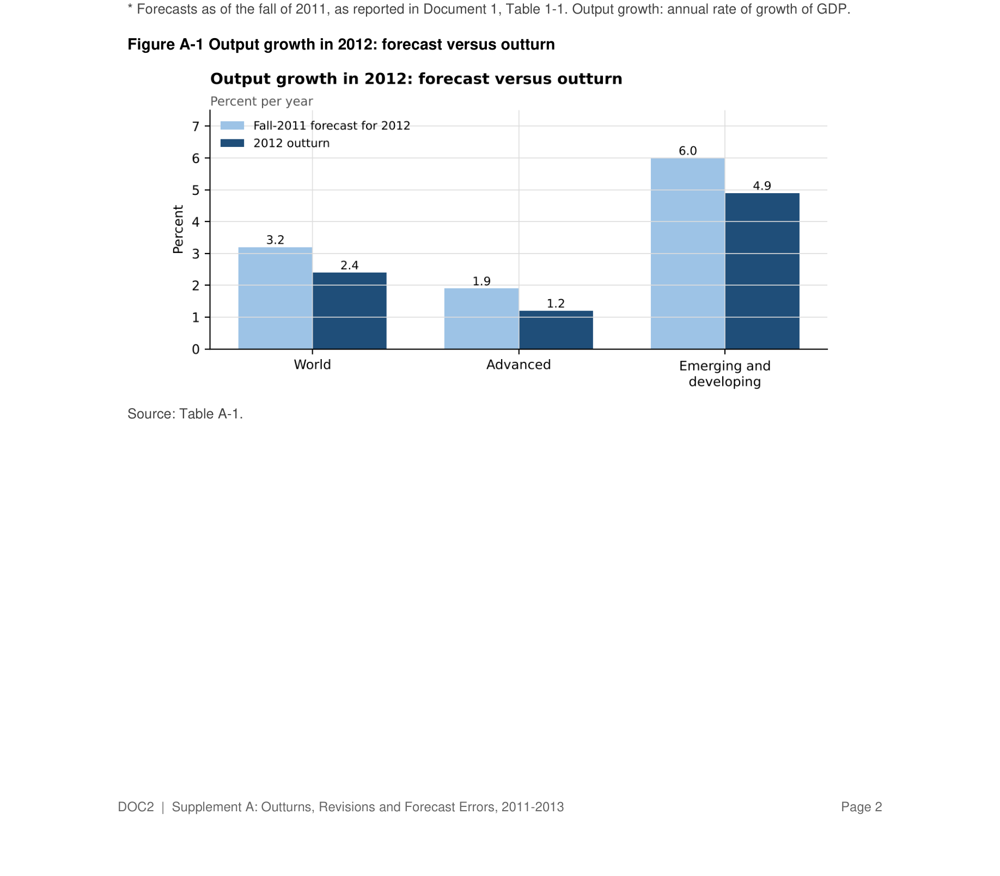

```
DOC2  |  Supplement A: Outturns, Revisions and Forecast Errors, 2011-2013
Page 2
A.1 World output after the crisis
Table A-1 sets the fall-2011 forecasts reported in Table 1-1 of Document 1 against the outturns. Every
group grew more slowly than forecast in 2012. The forecast error was largest for emerging and
developing economies in absolute terms, although they still grew about four times as fast as advanced
economies.
Table A-1 World output growth: forecasts and outturns, 2011-2013
Percent
2011
forecast*
2011 outturn
2012
forecast*
2012 outturn
2013 outturn
World
3.0
2.8
3.2
2.4
2.4
Advanced economies
1.6
1.5
1.9
1.2
1.1
Emerging and developing
economies
6.4
6.2
6.0
4.9
4.6
* Forecasts as of the fall of 2011, as reported in Document 1, Table 1-1. Output growth: annual rate of growth of GDP.
Figure A-1 Output growth in 2012: forecast versus outturn
Source: Table A-1.
```

**`DOC2:p2`**

```
DOC2  |  Supplement A: Outturns, Revisions and Forecast Errors, 2011-2013
Page 2
A.1 World output after the crisis
Table A-1 sets the fall-2011 forecasts reported in Table 1-1 of Document 1 against the outturns. Every
group grew more slowly than forecast in 2012. The forecast error was largest for emerging and
developing economies in absolute terms, although they still grew about four times as fast as advanced
economies.
Table A-1 World output growth: forecasts and outturns, 2011-2013
Percent
2011
forecast*
2011 outturn
2012
forecast*
2012 outturn
2013 outturn
World
3.0
2.8
3.2
2.4
2.4
Advanced economies
1.6
1.5
1.9
1.2
1.1
Emerging and developing
economies
6.4
6.2
6.0
4.9
4.6
* Forecasts as of the fall of 2011, as reported in Document 1, Table 1-1. Output growth: annual rate of growth of GDP.
Figure A-1 Output growth in 2012: forecast versus outturn
Source: Table A-1.
```

**`DOC2:Table A-1`**

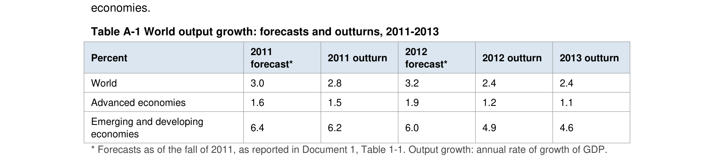

```
DOC2  |  Supplement A: Outturns, Revisions and Forecast Errors, 2011-2013
Page 2
A.1 World output after the crisis
Table A-1 sets the fall-2011 forecasts reported in Table 1-1 of Document 1 against the outturns. Every
group grew more slowly than forecast in 2012. The forecast error was largest for emerging and
developing economies in absolute terms, although they still grew about four times as fast as advanced
economies.
Table A-1 World output growth: forecasts and outturns, 2011-2013
Percent
2011
forecast*
2011 outturn
2012
forecast*
2012 outturn
2013 outturn
World
3.0
2.8
3.2
2.4
2.4
Advanced economies
1.6
1.5
1.9
1.2
1.1
Emerging and developing
economies
6.4
6.2
6.0
4.9
4.6
* Forecasts as of the fall of 2011, as reported in Document 1, Table 1-1. Output growth: annual rate of growth of GDP.
Figure A-1 Output growth in 2012: forecast versus outturn
Source: Table A-1.
```

**rating_tejas:** ____

---

## G21

**Question.** Did the July 2013 benchmark revision change any 2008-2010 value in Document 1 other than the one it describes?

**The answer the system gave.** No, the July 2013 benchmark revision did not change any 2008-2010 value in Document 1 other than the U.S. output growth for 2010.

- status: `answered`
- citations: `DOC2:p7,DOC2:Table A-2,DOC2:p3`

- the golden set expected: No. Only U.S. output growth for 2010 was revised, from 3.0% to 2.4%.

- Shriram rated this **4**

### What the cited sources actually say

**`DOC2:p7`**

```
DOC2  |  Supplement A: Outturns, Revisions and Forecast Errors, 2011-2013
Page 7
A.6 The U.S. federal budget
Table A-3 extends the budget figures discussed in Document 1. The deficit peaked in 2009 and then
narrowed every year, as revenues recovered with output and crisis-related spending was phased out.
By 2013 the deficit was back below 5% of GDP, the level Document 1 expected to be reached only "by
the middle of the decade".
Table A-3 U.S. federal revenues, spending and budget balance, 2007-2013
Percent of GDP
Revenues
Spending
Budget balance
2007
18.9
20.6
-1.7
2008
17.6
20.8
-3.2
2009
15.1
25.2
-10.1
2010
16.2
25.3
-9.1
2011
15.8
24.5
-8.7
2012
16.4
23.2
-6.8
2013
17.5
21.6
-4.1
A negative budget balance is a deficit. Values for 2007 and 2010 match those quoted in Document 1.
A.7 Vintages, revisions and how to cite this supplement
1. Outturns supersede forecasts. Where Document 1 gives a forecast (marked *) for 2011 or 2012
and this supplement gives an outturn for the same year and variable, the outturn is the current value.
2. Explicit revisions supersede earlier values. The only revision in this supplement is U.S. output
growth for 2010 (see the revision notice in A.2).
3. Near-identical figures. Figures A-2/A-3, A-4/A-5 and A-6/A-7 are deliberately drawn with the same
template. Cite the exact figure number, and state the vintage, base date or year it refers to.
4. Cite this document as DOC2 with a page number, table or figure, for example "DOC2:Table A-2" or
"DOC2:Figure A-3".
```

**`DOC2:Table A-2`**

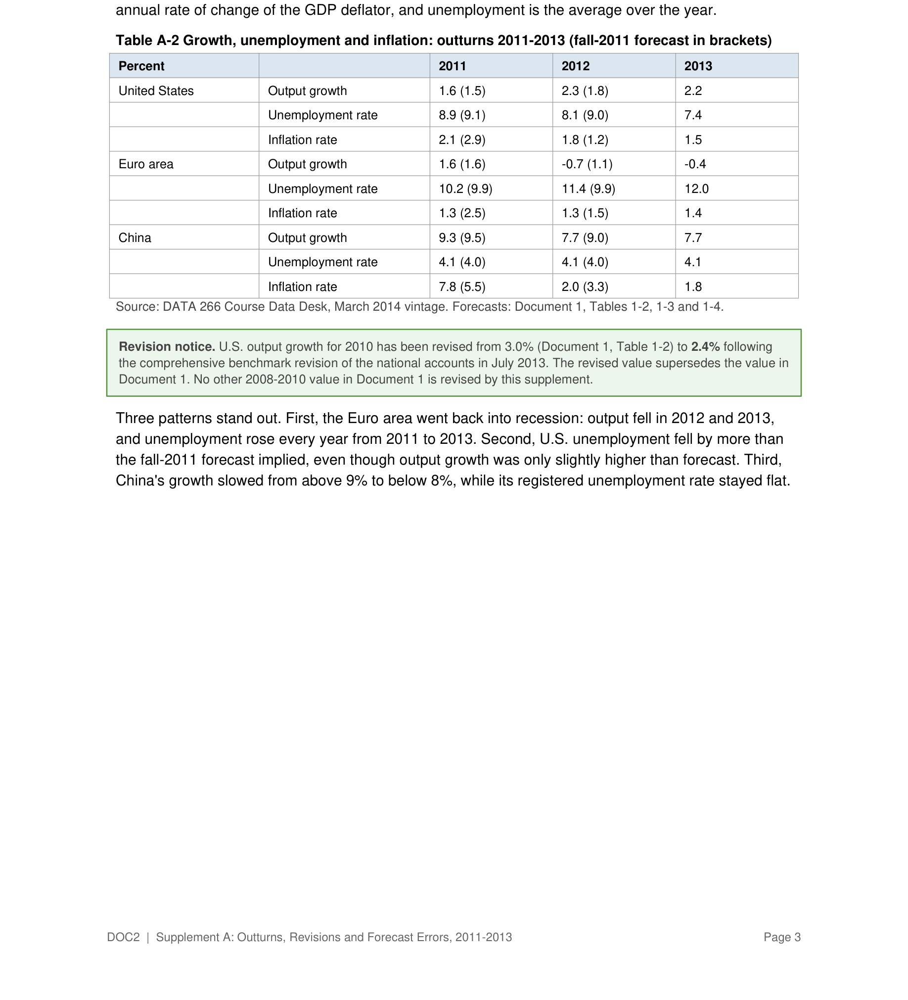

```
DOC2  |  Supplement A: Outturns, Revisions and Forecast Errors, 2011-2013
Page 3
A.2 The United States, the Euro area and China
Table A-2 reports outturns for the three economies discussed in Document 1. The fall-2011 forecast is
shown in brackets after each 2011 and 2012 outturn. Definitions follow Document 1: inflation is the
annual rate of change of the GDP deflator, and unemployment is the average over the year.
Table A-2 Growth, unemployment and inflation: outturns 2011-2013 (fall-2011 forecast in brackets)
Percent
2011
2012
2013
United States
Output growth
1.6 (1.5)
2.3 (1.8)
2.2
Unemployment rate
8.9 (9.1)
8.1 (9.0)
7.4
Inflation rate
2.1 (2.9)
1.8 (1.2)
1.5
Euro area
Output growth
1.6 (1.6)
-0.7 (1.1)
-0.4
Unemployment rate
10.2 (9.9)
11.4 (9.9)
12.0
Inflation rate
1.3 (2.5)
1.3 (1.5)
1.4
China
Output growth
9.3 (9.5)
7.7 (9.0)
7.7
Unemployment rate
4.1 (4.0)
4.1 (4.0)
4.1
Inflation rate
7.8 (5.5)
2.0 (3.3)
1.8
Source: DATA 266 Course Data Desk, March 2014 vintage. Forecasts: Document 1, Tables 1-2, 1-3 and 1-4.
Revision notice. U.S. output growth for 2010 has been revised from 3.0% (Document 1, Table 1-2) to 2.4% following
the comprehensive benchmark revision of the national accounts in July 2013. The revised value supersedes the value in
Document 1. No other 2008-2010 value in Document 1 is revised by this supplement.
Three patterns stand out. First, the Euro area went back into recession: output fell in 2012 and 2013,
and unemployment rose every year from 2011 to 2013. Second, U.S. unemployment fell by more than
the fall-2011 forecast implied, even though output growth was only slightly higher than forecast. Third,
China's growth slowed from above 9% to below 8%, while its registered unemployment rate stayed flat.
```

**`DOC2:p3`**

```
DOC2  |  Supplement A: Outturns, Revisions and Forecast Errors, 2011-2013
Page 3
A.2 The United States, the Euro area and China
Table A-2 reports outturns for the three economies discussed in Document 1. The fall-2011 forecast is
shown in brackets after each 2011 and 2012 outturn. Definitions follow Document 1: inflation is the
annual rate of change of the GDP deflator, and unemployment is the average over the year.
Table A-2 Growth, unemployment and inflation: outturns 2011-2013 (fall-2011 forecast in brackets)
Percent
2011
2012
2013
United States
Output growth
1.6 (1.5)
2.3 (1.8)
2.2
Unemployment rate
8.9 (9.1)
8.1 (9.0)
7.4
Inflation rate
2.1 (2.9)
1.8 (1.2)
1.5
Euro area
Output growth
1.6 (1.6)
-0.7 (1.1)
-0.4
Unemployment rate
10.2 (9.9)
11.4 (9.9)
12.0
Inflation rate
1.3 (2.5)
1.3 (1.5)
1.4
China
Output growth
9.3 (9.5)
7.7 (9.0)
7.7
Unemployment rate
4.1 (4.0)
4.1 (4.0)
4.1
Inflation rate
7.8 (5.5)
2.0 (3.3)
1.8
Source: DATA 266 Course Data Desk, March 2014 vintage. Forecasts: Document 1, Tables 1-2, 1-3 and 1-4.
Revision notice. U.S. output growth for 2010 has been revised from 3.0% (Document 1, Table 1-2) to 2.4% following
the comprehensive benchmark revision of the national accounts in July 2013. The revised value supersedes the value in
Document 1. No other 2008-2010 value in Document 1 is revised by this supplement.
Three patterns stand out. First, the Euro area went back into recession: output fell in 2012 and 2013,
and unemployment rose every year from 2011 to 2013. Second, U.S. unemployment fell by more than
the fall-2011 forecast implied, even though output growth was only slightly higher than forecast. Third,
China's growth slowed from above 9% to below 8%, while its registered unemployment rate stayed flat.
```

**rating_tejas:** ____

---

## G22

**Question.** Which value should be used for U.S. inflation in 2012, and what does it replace?

**The answer the system gave.** The U.S. inflation rate for 2012 is 1.8%, replacing the forecasted value of 1.2%.

- status: `answered`
- citations: `DOC2:Table A-2,DOC2:p3`

- the golden set expected: 1.8% (outturn), which replaces the 1.2% forecast.

- Shriram rated this **5**

### What the cited sources actually say

**`DOC2:Table A-2`**


```
DOC2  |  Supplement A: Outturns, Revisions and Forecast Errors, 2011-2013
Page 3
A.2 The United States, the Euro area and China
Table A-2 reports outturns for the three economies discussed in Document 1. The fall-2011 forecast is
shown in brackets after each 2011 and 2012 outturn. Definitions follow Document 1: inflation is the
annual rate of change of the GDP deflator, and unemployment is the average over the year.
Table A-2 Growth, unemployment and inflation: outturns 2011-2013 (fall-2011 forecast in brackets)
Percent
2011
2012
2013
United States
Output growth
1.6 (1.5)
2.3 (1.8)
2.2
Unemployment rate
8.9 (9.1)
8.1 (9.0)
7.4
Inflation rate
2.1 (2.9)
1.8 (1.2)
1.5
Euro area
Output growth
1.6 (1.6)
-0.7 (1.1)
-0.4
Unemployment rate
10.2 (9.9)
11.4 (9.9)
12.0
Inflation rate
1.3 (2.5)
1.3 (1.5)
1.4
China
Output growth
9.3 (9.5)
7.7 (9.0)
7.7
Unemployment rate
4.1 (4.0)
4.1 (4.0)
4.1
Inflation rate
7.8 (5.5)
2.0 (3.3)
1.8
Source: DATA 266 Course Data Desk, March 2014 vintage. Forecasts: Document 1, Tables 1-2, 1-3 and 1-4.
Revision notice. U.S. output growth for 2010 has been revised from 3.0% (Document 1, Table 1-2) to 2.4% following
the comprehensive benchmark revision of the national accounts in July 2013. The revised value supersedes the value in
Document 1. No other 2008-2010 value in Document 1 is revised by this supplement.
Three patterns stand out. First, the Euro area went back into recession: output fell in 2012 and 2013,
and unemployment rose every year from 2011 to 2013. Second, U.S. unemployment fell by more than
the fall-2011 forecast implied, even though output growth was only slightly higher than forecast. Third,
China's growth slowed from above 9% to below 8%, while its registered unemployment rate stayed flat.
```

**`DOC2:p3`**

```
DOC2  |  Supplement A: Outturns, Revisions and Forecast Errors, 2011-2013
Page 3
A.2 The United States, the Euro area and China
Table A-2 reports outturns for the three economies discussed in Document 1. The fall-2011 forecast is
shown in brackets after each 2011 and 2012 outturn. Definitions follow Document 1: inflation is the
annual rate of change of the GDP deflator, and unemployment is the average over the year.
Table A-2 Growth, unemployment and inflation: outturns 2011-2013 (fall-2011 forecast in brackets)
Percent
2011
2012
2013
United States
Output growth
1.6 (1.5)
2.3 (1.8)
2.2
Unemployment rate
8.9 (9.1)
8.1 (9.0)
7.4
Inflation rate
2.1 (2.9)
1.8 (1.2)
1.5
Euro area
Output growth
1.6 (1.6)
-0.7 (1.1)
-0.4
Unemployment rate
10.2 (9.9)
11.4 (9.9)
12.0
Inflation rate
1.3 (2.5)
1.3 (1.5)
1.4
China
Output growth
9.3 (9.5)
7.7 (9.0)
7.7
Unemployment rate
4.1 (4.0)
4.1 (4.0)
4.1
Inflation rate
7.8 (5.5)
2.0 (3.3)
1.8
Source: DATA 266 Course Data Desk, March 2014 vintage. Forecasts: Document 1, Tables 1-2, 1-3 and 1-4.
Revision notice. U.S. output growth for 2010 has been revised from 3.0% (Document 1, Table 1-2) to 2.4% following
the comprehensive benchmark revision of the national accounts in July 2013. The revised value supersedes the value in
Document 1. No other 2008-2010 value in Document 1 is revised by this supplement.
Three patterns stand out. First, the Euro area went back into recession: output fell in 2012 and 2013,
and unemployment rose every year from 2011 to 2013. Second, U.S. unemployment fell by more than
the fall-2011 forecast implied, even though output growth was only slightly higher than forecast. Third,
China's growth slowed from above 9% to below 8%, while its registered unemployment rate stayed flat.
```

**rating_tejas:** ____

---

## G23

**Question.** What was Japan's output growth in 2012?

**The answer the system gave.** The trusted documents do not contain this information.

- status: `not_found`
- citations: `NONE`

- the golden set expected: Not supported by the trusted documents.

- Shriram rated this **5**

### What the cited sources actually say

The answer cites nothing. Rate whether a claim is being made that would have needed a source.

**rating_tejas:** ____

---

## G24

**Question.** Why did U.S. output growth stay negative throughout 2010?

**The answer the system gave.** U.S. output growth stayed negative throughout 2010 because the U.S. economy experienced a recession, leading to a decline in GDP.

- status: `answered`
- citations: `DOC1:p5,DOC2:Table A-2,DOC2:p3`

- the golden set expected: The premise is false: U.S. output growth in 2010 was positive (2.4% after revision).

- Shriram rated this **1**

### What the cited sources actually say

**`DOC1:p5`**

```
8 
Introduction 
The Core
Then the crisis came, and you can see it in the numbers from 2008 onward. Output 
did not grow in 2008 and declined by 3.5% in 2009. Unemployment increased dramati-
cally, to nearly 10%. Inflation declined, being slightly negative in 2009 and then staying 
positive but low since then. The economy rebounded in 2010, with growth of 3%. Since 
then, however, growth has decreased again, becoming so weak that unemployment is 
forecast to remain high for a long time to come. Inflation is forecast to remain low.
Apart from high unemployment, perhaps the most serious macroeconomic prob-
lem facing the United States is its very large budget deficit. We now turn to it, and to 
some of its implications.
Should You Worry about the United States Deficit?
Figure 1-4 shows the evolution of the U.S. federal budget surplus (a negative value 
represents a deficit) since 1990. You can see that after an increase in deficits due 
to the 1990–1991 recession, the rest of the decade was associated with a steady 
improvement and by 1998, the budget had actually gone from deficit to surplus. The 
main reasons for the steady improvement were twofold. First, strong output growth 
Table 1-2 Growth, Unemployment, and Inflation in the United States, 1980–2012
Percent
1980–1999 
(average)
2000–2007 
(average)
2008
2009
2010
2011
2012
Output growth rate
3.0
2.6
0.0
−3.5
3.0
1.5
1.8
Unemployment rate
6.5
5.0
5.8
9.3
9.6
9.1
9.0
Inflation rate
4.2
2.8
3.8
−0.3
1.7
2.9
1.2
Output growth rate: annual rate of growth of output (GDP). Unemployment rate: average over the year. Inflation rate: 
annual rate of change of the price level (GDP deflator). 
Source: World Economic Outlook database, September 2011
Figure 1-4
U.S. Federal Budget 
surpluses as a percent of 
GDP since 1990
Source: Table B-79 Economic 
 Report of the President 2010. 
Values for 2011 and 2012 are 
estimates.
–12
–10
–8
–6
–4
–2
0
2
4
1990
1992
1994
1996
1998
2000
2002
2004
2006
2008
2010
Percent
```

**`DOC2:Table A-2`**


```
DOC2  |  Supplement A: Outturns, Revisions and Forecast Errors, 2011-2013
Page 3
A.2 The United States, the Euro area and China
Table A-2 reports outturns for the three economies discussed in Document 1. The fall-2011 forecast is
shown in brackets after each 2011 and 2012 outturn. Definitions follow Document 1: inflation is the
annual rate of change of the GDP deflator, and unemployment is the average over the year.
Table A-2 Growth, unemployment and inflation: outturns 2011-2013 (fall-2011 forecast in brackets)
Percent
2011
2012
2013
United States
Output growth
1.6 (1.5)
2.3 (1.8)
2.2
Unemployment rate
8.9 (9.1)
8.1 (9.0)
7.4
Inflation rate
2.1 (2.9)
1.8 (1.2)
1.5
Euro area
Output growth
1.6 (1.6)
-0.7 (1.1)
-0.4
Unemployment rate
10.2 (9.9)
11.4 (9.9)
12.0
Inflation rate
1.3 (2.5)
1.3 (1.5)
1.4
China
Output growth
9.3 (9.5)
7.7 (9.0)
7.7
Unemployment rate
4.1 (4.0)
4.1 (4.0)
4.1
Inflation rate
7.8 (5.5)
2.0 (3.3)
1.8
Source: DATA 266 Course Data Desk, March 2014 vintage. Forecasts: Document 1, Tables 1-2, 1-3 and 1-4.
Revision notice. U.S. output growth for 2010 has been revised from 3.0% (Document 1, Table 1-2) to 2.4% following
the comprehensive benchmark revision of the national accounts in July 2013. The revised value supersedes the value in
Document 1. No other 2008-2010 value in Document 1 is revised by this supplement.
Three patterns stand out. First, the Euro area went back into recession: output fell in 2012 and 2013,
and unemployment rose every year from 2011 to 2013. Second, U.S. unemployment fell by more than
the fall-2011 forecast implied, even though output growth was only slightly higher than forecast. Third,
China's growth slowed from above 9% to below 8%, while its registered unemployment rate stayed flat.
```

**`DOC2:p3`**

```
DOC2  |  Supplement A: Outturns, Revisions and Forecast Errors, 2011-2013
Page 3
A.2 The United States, the Euro area and China
Table A-2 reports outturns for the three economies discussed in Document 1. The fall-2011 forecast is
shown in brackets after each 2011 and 2012 outturn. Definitions follow Document 1: inflation is the
annual rate of change of the GDP deflator, and unemployment is the average over the year.
Table A-2 Growth, unemployment and inflation: outturns 2011-2013 (fall-2011 forecast in brackets)
Percent
2011
2012
2013
United States
Output growth
1.6 (1.5)
2.3 (1.8)
2.2
Unemployment rate
8.9 (9.1)
8.1 (9.0)
7.4
Inflation rate
2.1 (2.9)
1.8 (1.2)
1.5
Euro area
Output growth
1.6 (1.6)
-0.7 (1.1)
-0.4
Unemployment rate
10.2 (9.9)
11.4 (9.9)
12.0
Inflation rate
1.3 (2.5)
1.3 (1.5)
1.4
China
Output growth
9.3 (9.5)
7.7 (9.0)
7.7
Unemployment rate
4.1 (4.0)
4.1 (4.0)
4.1
Inflation rate
7.8 (5.5)
2.0 (3.3)
1.8
Source: DATA 266 Course Data Desk, March 2014 vintage. Forecasts: Document 1, Tables 1-2, 1-3 and 1-4.
Revision notice. U.S. output growth for 2010 has been revised from 3.0% (Document 1, Table 1-2) to 2.4% following
the comprehensive benchmark revision of the national accounts in July 2013. The revised value supersedes the value in
Document 1. No other 2008-2010 value in Document 1 is revised by this supplement.
Three patterns stand out. First, the Euro area went back into recession: output fell in 2012 and 2013,
and unemployment rose every year from 2011 to 2013. Second, U.S. unemployment fell by more than
the fall-2011 forecast implied, even though output growth was only slightly higher than forecast. Third,
China's growth slowed from above 9% to below 8%, while its registered unemployment rate stayed flat.
```

**rating_tejas:** ____

---

## G25

**Question.** What was U.S. inflation in 2009?

**The answer the system gave.** -0.3%

- status: `answered`
- citations: `DOC1:Table 1-2,DOC1:p5,DOC2:Table A-2,DOC2:p3`

- the golden set expected: -0.3%

- Shriram rated this **4**

### What the cited sources actually say

**`DOC1:Table 1-2`**

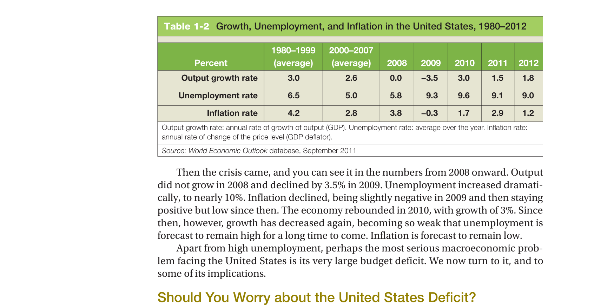

```
8 
Introduction 
The Core
Then the crisis came, and you can see it in the numbers from 2008 onward. Output 
did not grow in 2008 and declined by 3.5% in 2009. Unemployment increased dramati-
cally, to nearly 10%. Inflation declined, being slightly negative in 2009 and then staying 
positive but low since then. The economy rebounded in 2010, with growth of 3%. Since 
then, however, growth has decreased again, becoming so weak that unemployment is 
forecast to remain high for a long time to come. Inflation is forecast to remain low.
Apart from high unemployment, perhaps the most serious macroeconomic prob-
lem facing the United States is its very large budget deficit. We now turn to it, and to 
some of its implications.
Should You Worry about the United States Deficit?
Figure 1-4 shows the evolution of the U.S. federal budget surplus (a negative value 
represents a deficit) since 1990. You can see that after an increase in deficits due 
to the 1990–1991 recession, the rest of the decade was associated with a steady 
improvement and by 1998, the budget had actually gone from deficit to surplus. The 
main reasons for the steady improvement were twofold. First, strong output growth 
Table 1-2 Growth, Unemployment, and Inflation in the United States, 1980–2012
Percent
1980–1999 
(average)
2000–2007 
(average)
2008
2009
2010
2011
2012
Output growth rate
3.0
2.6
0.0
−3.5
3.0
1.5
1.8
Unemployment rate
6.5
5.0
5.8
9.3
9.6
9.1
9.0
Inflation rate
4.2
2.8
3.8
−0.3
1.7
2.9
1.2
Output growth rate: annual rate of growth of output (GDP). Unemployment rate: average over the year. Inflation rate: 
annual rate of change of the price level (GDP deflator). 
Source: World Economic Outlook database, September 2011
Figure 1-4
U.S. Federal Budget 
surpluses as a percent of 
GDP since 1990
Source: Table B-79 Economic 
 Report of the President 2010. 
Values for 2011 and 2012 are 
estimates.
–12
–10
–8
–6
–4
–2
0
2
4
1990
1992
1994
1996
1998
2000
2002
2004
2006
2008
2010
Percent
```

**`DOC1:p5`**

```
8 
Introduction 
The Core
Then the crisis came, and you can see it in the numbers from 2008 onward. Output 
did not grow in 2008 and declined by 3.5% in 2009. Unemployment increased dramati-
cally, to nearly 10%. Inflation declined, being slightly negative in 2009 and then staying 
positive but low since then. The economy rebounded in 2010, with growth of 3%. Since 
then, however, growth has decreased again, becoming so weak that unemployment is 
forecast to remain high for a long time to come. Inflation is forecast to remain low.
Apart from high unemployment, perhaps the most serious macroeconomic prob-
lem facing the United States is its very large budget deficit. We now turn to it, and to 
some of its implications.
Should You Worry about the United States Deficit?
Figure 1-4 shows the evolution of the U.S. federal budget surplus (a negative value 
represents a deficit) since 1990. You can see that after an increase in deficits due 
to the 1990–1991 recession, the rest of the decade was associated with a steady 
improvement and by 1998, the budget had actually gone from deficit to surplus. The 
main reasons for the steady improvement were twofold. First, strong output growth 
Table 1-2 Growth, Unemployment, and Inflation in the United States, 1980–2012
Percent
1980–1999 
(average)
2000–2007 
(average)
2008
2009
2010
2011
2012
Output growth rate
3.0
2.6
0.0
−3.5
3.0
1.5
1.8
Unemployment rate
6.5
5.0
5.8
9.3
9.6
9.1
9.0
Inflation rate
4.2
2.8
3.8
−0.3
1.7
2.9
1.2
Output growth rate: annual rate of growth of output (GDP). Unemployment rate: average over the year. Inflation rate: 
annual rate of change of the price level (GDP deflator). 
Source: World Economic Outlook database, September 2011
Figure 1-4
U.S. Federal Budget 
surpluses as a percent of 
GDP since 1990
Source: Table B-79 Economic 
 Report of the President 2010. 
Values for 2011 and 2012 are 
estimates.
–12
–10
–8
–6
–4
–2
0
2
4
1990
1992
1994
1996
1998
2000
2002
2004
2006
2008
2010
Percent
```

**`DOC2:Table A-2`**


```
DOC2  |  Supplement A: Outturns, Revisions and Forecast Errors, 2011-2013
Page 3
A.2 The United States, the Euro area and China
Table A-2 reports outturns for the three economies discussed in Document 1. The fall-2011 forecast is
shown in brackets after each 2011 and 2012 outturn. Definitions follow Document 1: inflation is the
annual rate of change of the GDP deflator, and unemployment is the average over the year.
Table A-2 Growth, unemployment and inflation: outturns 2011-2013 (fall-2011 forecast in brackets)
Percent
2011
2012
2013
United States
Output growth
1.6 (1.5)
2.3 (1.8)
2.2
Unemployment rate
8.9 (9.1)
8.1 (9.0)
7.4
Inflation rate
2.1 (2.9)
1.8 (1.2)
1.5
Euro area
Output growth
1.6 (1.6)
-0.7 (1.1)
-0.4
Unemployment rate
10.2 (9.9)
11.4 (9.9)
12.0
Inflation rate
1.3 (2.5)
1.3 (1.5)
1.4
China
Output growth
9.3 (9.5)
7.7 (9.0)
7.7
Unemployment rate
4.1 (4.0)
4.1 (4.0)
4.1
Inflation rate
7.8 (5.5)
2.0 (3.3)
1.8
Source: DATA 266 Course Data Desk, March 2014 vintage. Forecasts: Document 1, Tables 1-2, 1-3 and 1-4.
Revision notice. U.S. output growth for 2010 has been revised from 3.0% (Document 1, Table 1-2) to 2.4% following
the comprehensive benchmark revision of the national accounts in July 2013. The revised value supersedes the value in
Document 1. No other 2008-2010 value in Document 1 is revised by this supplement.
Three patterns stand out. First, the Euro area went back into recession: output fell in 2012 and 2013,
and unemployment rose every year from 2011 to 2013. Second, U.S. unemployment fell by more than
the fall-2011 forecast implied, even though output growth was only slightly higher than forecast. Third,
China's growth slowed from above 9% to below 8%, while its registered unemployment rate stayed flat.
```

**`DOC2:p3`**

```
DOC2  |  Supplement A: Outturns, Revisions and Forecast Errors, 2011-2013
Page 3
A.2 The United States, the Euro area and China
Table A-2 reports outturns for the three economies discussed in Document 1. The fall-2011 forecast is
shown in brackets after each 2011 and 2012 outturn. Definitions follow Document 1: inflation is the
annual rate of change of the GDP deflator, and unemployment is the average over the year.
Table A-2 Growth, unemployment and inflation: outturns 2011-2013 (fall-2011 forecast in brackets)
Percent
2011
2012
2013
United States
Output growth
1.6 (1.5)
2.3 (1.8)
2.2
Unemployment rate
8.9 (9.1)
8.1 (9.0)
7.4
Inflation rate
2.1 (2.9)
1.8 (1.2)
1.5
Euro area
Output growth
1.6 (1.6)
-0.7 (1.1)
-0.4
Unemployment rate
10.2 (9.9)
11.4 (9.9)
12.0
Inflation rate
1.3 (2.5)
1.3 (1.5)
1.4
China
Output growth
9.3 (9.5)
7.7 (9.0)
7.7
Unemployment rate
4.1 (4.0)
4.1 (4.0)
4.1
Inflation rate
7.8 (5.5)
2.0 (3.3)
1.8
Source: DATA 266 Course Data Desk, March 2014 vintage. Forecasts: Document 1, Tables 1-2, 1-3 and 1-4.
Revision notice. U.S. output growth for 2010 has been revised from 3.0% (Document 1, Table 1-2) to 2.4% following
the comprehensive benchmark revision of the national accounts in July 2013. The revised value supersedes the value in
Document 1. No other 2008-2010 value in Document 1 is revised by this supplement.
Three patterns stand out. First, the Euro area went back into recession: output fell in 2012 and 2013,
and unemployment rose every year from 2011 to 2013. Second, U.S. unemployment fell by more than
the fall-2011 forecast implied, even though output growth was only slightly higher than forecast. Third,
China's growth slowed from above 9% to below 8%, while its registered unemployment rate stayed flat.
```

**rating_tejas:** ____

---
